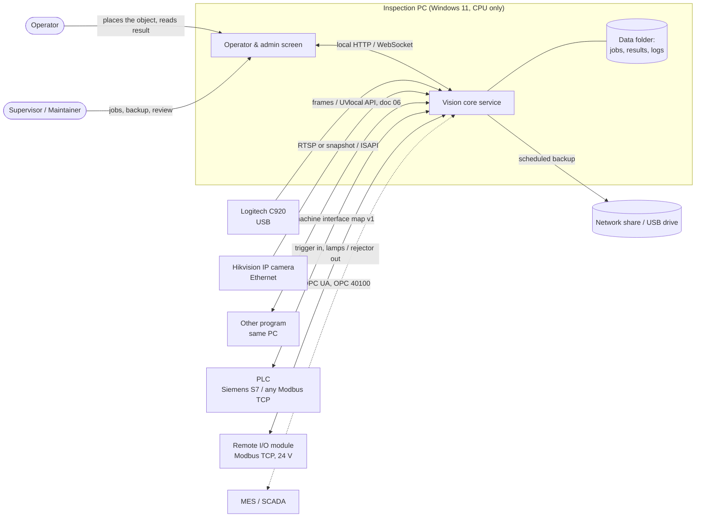
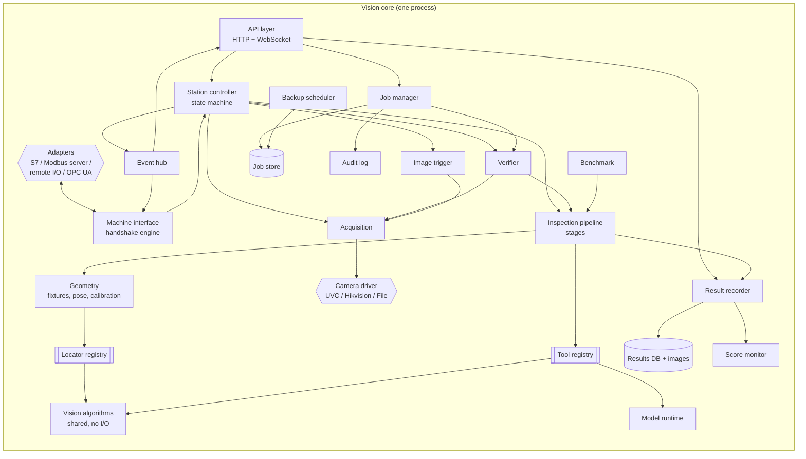
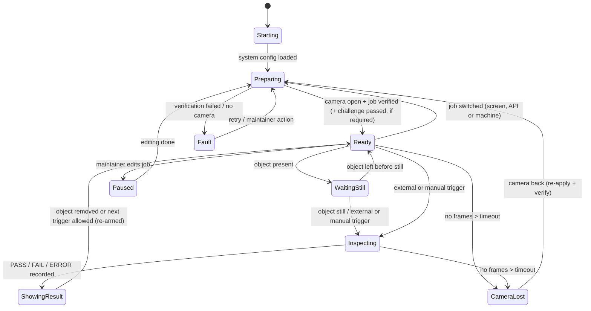
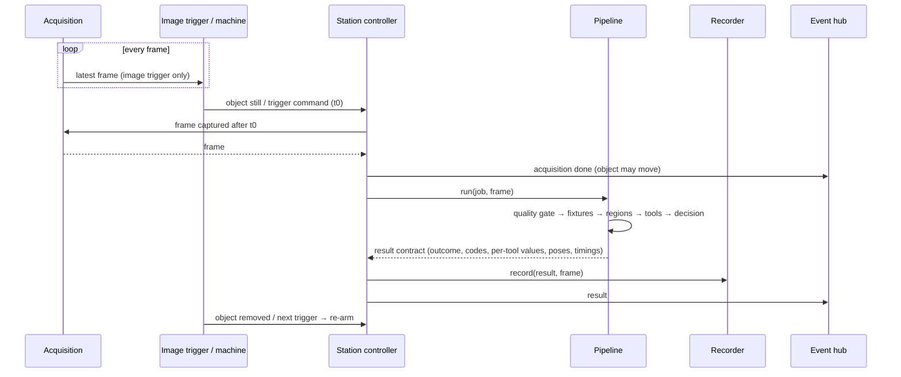
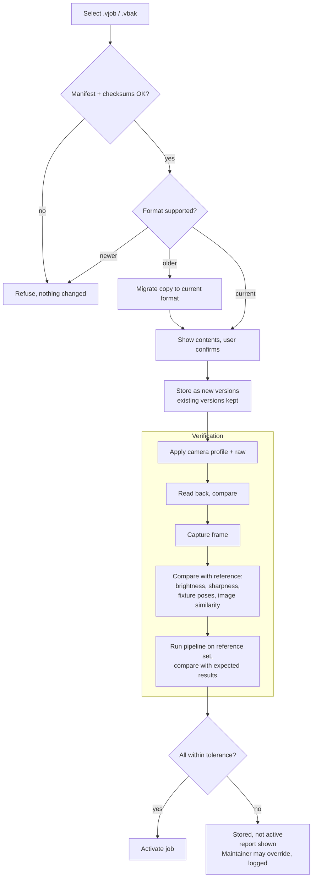
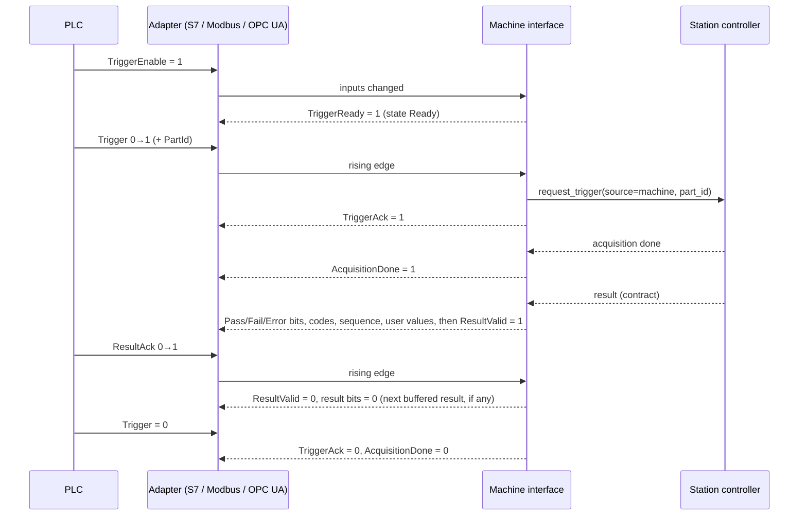
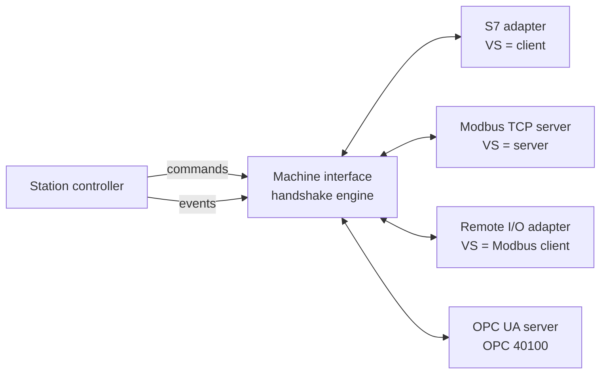

# Vision Station — Architecture ("job" model)

| | |
|---|---|
| Document | 03 — Architecture |
| Version | 0.6 — the job's acquisition block and the two layers, job and station (§4.1, §4.2, §4.5, §4.6, TD-32). 0.5 — remote I/O outputs, delayed reject and trigger timing (§16.7, TD-31). 0.4 — robust core: pose-based fixtures, result contract, machine connectors, validated tool catalog, CPU-only tiers |
| Date | 2026-10-18 |
| Author | Lucas (developer and maintainer) |
| Status | Platform architecture. Sections 1–13 describe the system; sections 14–19 are new in 0.4 and describe the target the refactors (§18) lead to. Where the code is not there yet, the text says so. |

> **Platform (TD-19).** Vision Station is a general vision system for **fixed stations**: a fixed camera and an object that is still while it is inspected. This document describes the platform. A customer project uses it by configuring jobs; its jobs, reference images and context live in that project, not here. Examples (a part with a blue cap and a lot label on a jig) only illustrate.

Related documents: 01 — Project Scope · 02 — Requirements and Use Cases · 04 — Technical Decisions · 05 — Frontend · 06 — Integration · 07 — Models · 08 — Job file format.

This document describes **how** the system is organized. Library and platform choices are only named where they shape the structure; the reasons for each choice are in document 04 (TD-21..TD-28 are new in this version). Requirement IDs (FR-…, NFR-…, UC-…) refer to document 02.

**What changed in 0.4, in one paragraph.** The research on commercial and open systems (project docs 05 and 06: Cognex In-Sight, MVTec MERLIC, Keyence IV3, Overview.ai, QuaVis QuaSolo, open-aoi, OPC 40100) showed that Vision Station already follows the market's model (job → locate → tools → verdict → machine) and that its core rules (immutable versions, verification on restore, "never a false PASS") are stronger than most. What it lacks is what makes a vision system *robust in a machine*: an anchor that carries **rotation and scale**, **stable error and reason codes**, a **handshake with the PLC** that fails safe, a **minimum tool set** that integrators expect, a **definition of "validated"** for each tool, and **performance measured on the PC it runs on**. Sections 14–19 add these without changing the rules of sections 1–13.

---

## 1. Design principles

1. **The job is the unit of configuration.** Everything needed to reproduce an inspection lives inside a job. Nothing that affects a result may live only in code, the registry, or a camera's memory (FR-JOB-2). What describes the installation (wiring, network, identity, how jobs are selected) lives in the system configuration, not in the job. §4.6 tells which is which, following the two reference products (document 09 §19).
2. **Configuration lives on the PC, not on the camera.** The camera is treated as replaceable hardware. Its settings are written from the job on every start and read back. The job never trusts what the camera already holds (FR-ACQ-4).
3. **Saved jobs are never changed.** Editing creates a new version, so any version can be restored exactly (FR-JOB-5).
4. **A job is only active once verified.** Loading, importing or reconnecting always ends with a verification step (FR-JOB-9).
5. **Never a false PASS.** Any doubt (camera lost, bad image, verification failed, internal error) gives ERROR, never PASS (FR-INS-6). This holds on every output: screen, API, records **and machine signals** (principle 9).
6. **The camera is a plugin.** Inspection and job code never refer to a specific camera (NFR-POR-4).
7. **The inspection core doesn't depend on the OS.** OS-specific code is limited to camera drivers, the service wrapper and the installer (NFR-POR-2).
8. **Simple enough for one maintainer.** One core process, one local database, files on disk. No message brokers, no containers, no cloud (NFR-MAI-4).
9. **Machine outputs fail safe.** A PLC can only read "pass" while a result is explicitly valid. On start, on any loss (connector, core, camera) and between results, every result signal is off (NFR-REL-7, §16).
10. **One command path.** The screens, the local API and every machine connector drive the station through the same controller commands. No connector changes state by itself (§3, §16.4).
11. **Jobs carry data, never code.** Inspection logic ships only inside the signed program, versioned per tool type. A job holds parameters, images and models; it can never add executable code (FR-PLT-12). This is the opposite of systems that let a user upload a script.
12. **Measure, don't assume.** Each installation measures its own speed (benchmark, FR-ADM-5), each tool states its limits, and each model card states its latency per PC tier. Budgets are checked against measurements, not hopes.

The job model follows the vocabulary of the OPC UA Machine Vision companion specification (OPC 40100-1):
- **system configuration**: per installation;
- **recipe**: per product, which we call a job;
- **product**: the name the outside world uses for what is inspected, linked to a job (system configuration, §4.5);
- **job execution**: one inspection.

The OPC UA server itself is an adapter (§16.6); using the same concepts everywhere keeps it a thin translation.

---

## 2. System context



The PC has two network ports (document 04 §4): one **only** for the camera, one for the machine/plant network. Machine connectors bind to the machine-network interface only (NFR-SEC-4).

---

## 3. Components



| Component | Responsibility | Requirements |
|---|---|---|
| **Station controller** | Owns the station's state machine (§6). Runs the inspection cycle, switches jobs, handles camera loss. It is the only component that changes the station's state. Takes commands from the API and from the machine interface through the same methods (principle 10). | FR-TRG-4, FR-INS-6, UC-01/02/09/10/11/12 |
| **Event hub** | Delivers state, acquisition-done and result events from the controller thread to the WebSocket clients and to the machine interface. A slow consumer loses old events; it never slows the station. | FR-INT-1, FR-INT-10 |
| **Machine interface** | The handshake engine (§16): turns the controller's state and events into the machine signals of the interface map, and machine signals into controller commands. Owns result buffering and acknowledgement, heartbeats and fail-safe resets. Knows nothing about protocols. | FR-INT-3, FR-INT-8..12, NFR-REL-7/8 |
| **Adapters** | One per protocol: S7 client, Modbus TCP server, Modbus TCP remote-I/O client, OPC UA server. Each only moves the interface map's fields to and from the wire. | FR-INT-4..7 |
| **Job manager** | Creates, versions, lists, activates, imports and exports jobs. Builds and reads job files and backup files. Migrates older job formats on import. | FR-JOB-*, UC-03/04/05 |
| **Job store** | Files on disk, one folder per job version, never edited after saving (§4.4). | FR-JOB-1/5 |
| **Verifier** | Runs the verification procedure on activation, import and reconnect (§7.3), and the A/B replay before a new version is activated (§7.7). | FR-JOB-9, FR-JOB-12, FR-ACQ-4/7 |
| **Acquisition** | Keeps the camera open. Holds only the **latest** frame, in a dedicated thread. Hands the station controller a frame captured after a given moment. Detects stalls and reconnects. | FR-ACQ-5/6, NFR-REL-3 |
| **Camera driver** | Camera-specific code behind one interface (§5). Applies and reads back settings, delivers frames, reports capabilities. | FR-ACQ-1..4/8, NFR-POR-4 |
| **Image trigger** | Decides when an object is present and still. Re-arms only after the object leaves. External triggers come through the controller's commands, not through this component. | FR-TRG-* |
| **Inspection pipeline** | Runs the job's stages on one frame (§7.1): quality gate → fixtures → regions → tools → decision. Returns a result in the result contract (§10.3). Never raises. | FR-INS-* |
| **Geometry** | Pose and fixtures (§14): runs the job's locators in order, keeps each fixture's pose, maps regions from fixture coordinates to pixels, cuts upright region images for the tools, converts pixels to millimetres when the job is calibrated. | FR-INS-8/11/12/15 |
| **Locator / tool registries** | Named, versioned types with a parameter schema (§15). A job refers to them by name and version; an unsupported version refuses the job. | FR-INS-5, FR-PLT-1/2/8..12 |
| **Vision algorithms** | Shared, pure functions (matching, edges and calipers, blobs, color, variation model). No job, camera or file access, so they are easy to test and benchmark. Tools and locators are thin wrappers around them. | NFR-MAI-5 |
| **Model runtime** | Loads the job's model files (ONNX / OpenVINO IR), verifies the checksum, runs inference on the CPU (§9). | FR-MDL-3/5/6, NFR-PERF-3 |
| **Result recorder** | Writes the inspection record and decides which images to keep. Applies retention and disk limits. | FR-LOG-1..3 |
| **Score monitor** | Keeps, per job version and tool, the distribution of scores and margins on PASS results; warns when the margin to the threshold shrinks (§8). | FR-LOG-7 |
| **Backup scheduler** | Makes scheduled and on-change backups, verifies them, rotates old ones. | FR-JOB-10 |
| **Audit log** | Append-only record of job changes, imports, exports, overrides, logins and machine-initiated job changes. | FR-LOG-5 |
| **Benchmark** | Runs a fixed workload and the active jobs on stored images, records times per stage, classifies the PC tier (§11). | FR-ADM-5, NFR-PERF-5 |
| **API layer** | Local interface used by the screens and by other programs on the PC. Pushes the live view, state and results to the screen. | FR-INT-1, FR-UI-* |
| **Operator & admin screen** | Shows the live image, result, reason, state and counters. Logged-in screens for jobs, results, backup and settings. | FR-UI-*, FR-ADM-1 |

### 3.1 Processes

| Process | Runs as | Restart policy |
|---|---|---|
| Vision core | Background service, starts with Windows, runs without a logged-in user | Restarted automatically by the OS service manager on crash (NFR-REL-6) |
| Operator screen | Full-screen app in the operator's session, opened at login | Reconnects to the core if the core restarts |

The screen is just a viewer. If the screen crashes or is closed, inspection keeps running and keeps being recorded. Machine connectors live **inside** the core: if the core stops, the PLC sees the heartbeat stop and the result signals are already off (§16.5).

For the C920 prototype on Windows, opening a USB camera from a background service (no user session) may be blocked by Windows' camera access rules. If that happens, the prototype core runs as a start-up app in the operator's session, with a watchdog (TD-14).

### 3.2 Threads inside the core

| Thread | Work |
|---|---|
| Capture | Reads frames from the camera as fast as they come. Keeps only the newest one and its timestamp. |
| Station | Runs the state machine: trigger detection, inspection, recording. One inspection at a time. |
| API | Serves the screens; streams a reduced live view (NFR-PERF-4). |
| Machine I/O | One per enabled adapter: polls or serves the interface map at a fixed cycle (proposed 10 ms) and feeds the machine interface. Never runs vision code. |
| Housekeeping | Backups, retention, disk checks, camera health checks, score-monitor windows. |

The station thread is the only one that runs the pipeline. Tools may use native multi-threading inside OpenCV, NumPy or the model runtime; the thread count is capped per PC tier (§11) so the machine I/O and capture threads always get CPU time.

### 3.3 Package layout (target after the refactors of §18)

```
src/vision_station/
├── core/            # pure types shared everywhere: Pose, Fixture, result contract, error-code catalog
├── jobs/            # job model (format 2), camera profile
├── store/           # .vjob / .vbak archives, job store
├── cameras/         # driver interface; uvc, hikvision, file (genicam later)
├── station/         # acquisition, image trigger, controller (state machine)
├── pipeline/        # stages: quality, geometry, regions, tools, decision; overlay
├── geometry/        # fixtures, region mapping, calibration px→mm
├── algorithms/      # pure vision functions: matching, shape, calipers, blobs, color, variation model
├── locators/        # registry + fixed, template, blob, shape, edges
├── tools/           # registry + brightness, color, blob, edge, pattern, code, compare, detect (+ ocr, anomaly)
├── models/          # model runtime, model cards, on-station anomaly memory bank
├── machine/         # handshake engine + interface map; adapters: s7, modbus_server, remote_io, opcua
├── verification/    # verification, A/B replay
├── records/         # results, images, dataset, score monitor
├── system/          # system.yaml, housekeeping, benchmark
└── api/             # FastAPI: HTTP, WebSocket, login
```

Since R0 (2026-10-17) the packages `core/`, `algorithms/`, `geometry/`, `pipeline/` and `models/` exist and hold the code that was in single modules (`results.py`, `jobfiles.py`, `schema_labels.py`, `colors.py`, `tools/measures.py`, `verification/metrics.py`, `pipeline.py`, `models.py`), moved without changing behaviour. Still to come: `Pose` and `Fixture` in `core/` and fixtures in `geometry/` (R1, today the locator's `Anchor` in `locators/`), the error-code catalog in `core/` (R2), matching, shape and calipers in `algorithms/` (R4, R5), and `machine/` (R3).

---

## 4. The job

### 4.1 What a job contains

| Part | Content | Why it's in the job |
|---|---|---|
| Metadata | id, name, version, author, created/changed dates, description, parent version | Identify and trace |
| **Acquisition** (format 3; one block, TD-32) | **Trigger:** the type (`image_presence`, `manual`, `external`, `continuous`) with the parameters of that type: presence area, stillness time and thresholds; delay and debounce; minimum interval. **Image:** the camera profile (resolution, format, exposure and the target brightness, maximum and measuring region of *Auto uma vez*, gain, white balance, focus, zoom, orientation, image-processing switches) and the calibration. Written in full in every version (FR-JOB-16) | Same inspection moment and same image on any installation. Cognex keeps all of it in `AcquireImage` (document 09 §20) |
| Camera raw settings | The driver's own full settings dump (e.g. the Hikvision image-settings XML), including what a driver offers beyond the normalized settings (gain offset, HDR) | Restores settings we don't model by name |
| Geometry | Fixtures (an ordered list of locators, each optionally inside another fixture), and ROIs relative to a fixture or to the frame | Tolerates object placement, including rotation (NFR-ACC-4, §14) |
| Tools | Ordered list: tool type, type version, ROI, parameters, thresholds, reason message, whether it affects the result | Same decision logic |
| Decision rule | How tool results combine into PASS / FAIL (`all_pass` of the tools that affect the result) | Same final result |
| Image-quality limits (`quality`; no equivalent in the reference products) | Expected brightness and sharpness ranges vs. reference; optional color-reference patch with a drift limit | Detect drift (FR-ACQ-7, FR-INS-16) |
| Outputs (optional, format 3) | Which tool values are published to the machine interface as user values, with units | Same data to the PLC (FR-INT-11) |
| Model(s) | ONNX / OpenVINO files, checksum, model card (task, classes, input size, training data, metrics, latency per PC tier) | Same model, traceable |
| Taught data | Files a tool learned at the station: variation-model statistics, anomaly memory bank | Same decision after restore |
| Reference image | One image of a good object taken when the job was saved | Verify the camera view after restore |
| Reference set | Labeled images with their expected results | Verify the decision logic after restore |
| Challenge set (optional) | The names and expected results of the physical master parts used in the challenge test (UC-14) | Prove the station still sees a known defect |

What is **not** in a job: camera IP address and password, which PC folder to back up to, user accounts, licence keys, **the job's number for the PLC and the product names linked to it**, and every machine-connector setting. These belong to the **system configuration** (§4.5), because they describe the installation, not the product. Moving a job to another station never brings that station's PLC numbering with it.

### 4.2 Job file format (`.vjob`)

A job file is a ZIP archive with a fixed layout. Text files are UTF-8, and all paths are relative and use `/` (NFR-POR-3). The full specification is document 08.

```
tampa-azul-etiqueta_v7.vjob
├── manifest.json            # format version, job id/version, file list with SHA-256, app version that wrote it
├── job.yaml                 # metadata, acquisition (trigger, image), geometry, tools, decision rule, quality limits, outputs, screen texts
├── camera/
│   ├── profile.yaml         # normalized camera settings (driver-independent names)
│   ├── calibration.yaml     # format 3, optional: mm per px, distortion
│   └── raw/                 # driver-specific dumps, used only by the same driver
├── locators/                # templates and shape models used by locators
├── patterns/                # templates used by pattern tools
├── taught/                  # variation models, anomaly memory banks (format 3)
├── models/
│   ├── defects.onnx
│   └── defects.card.yaml
├── reference/
│   ├── reference.png
│   └── reference.meta.yaml  # brightness, sharpness, fixture poses measured on it
└── tests/
    ├── expected.yaml        # image → expected result, with tolerance on scores
    └── images/*.png
```

**Format 2** (R1, VIA-0070) changes the geometry (fixtures with a pose) and the texts (both languages); the optional parts and the `acquisition` block below are **format 3** (VIA-0084, as built: `jobs/job.py` `Acquisition`, written in full, no migrator). Example `job.yaml`, shortened:

```yaml
format: 2
job:
  id: 3f1c9a2e-...
  name: "Tampa azul — etiqueta de lote"
  version: 8
  parent_version: 7
  author: lucas
  created_at: 2026-11-20T15:40:00-03:00
acquisition:                                  # one block, written in full (TD-32, FR-JOB-16)
  trigger:
    type: external                            # the PLC triggers (UC-11); the line or protocol is station configuration
    external: {delay_ms: 0, debounce_ms: 0}
  image:
    profile: camera/profile.yaml              # resolution, format, exposure, gain, white balance, focus, zoom, orientation
    calibration: camera/calibration.yaml      # optional
quality:
  brightness: {min: 90, max: 170}
  sharpness_min_ratio: 0.7
  color_reference: {roi: white_patch, max_delta_e: 6}   # optional drift gate (FR-INS-16)
geometry:
  fixtures:
    - name: part                              # first fixture, searched in the frame
      locator: {type: shape, version: 1, params: {model: locators/part.shape, angle: [-15, 15], scale: [0.95, 1.05], min_score: 0.7}}
    - name: label                             # second fixture, searched inside the first
      inside: part
      search: [0.05, 0.40, 0.95, 0.90]        # fractions of the part fixture
      locator: {type: template, version: 1, params: {template: locators/label.png, min_score: 0.6}}
  rois:
    cap:        {relative_to: part,  rect: [0.30, 0.00, 0.70, 0.20]}
    lot:        {relative_to: label, rect: [0.10, 0.10, 0.90, 0.60]}
    white_patch: {relative_to: frame, rect: [0.02, 0.02, 0.06, 0.06]}
tools:
  - {id: tampa, type: color, version: 1, roi: cap, params: {hue: [100, 130], s_min: 120, v_min: 70, min_fraction: 0.80},
     reason_fail: "Tampa ausente ou de outra cor ({fraction:.0%} azul)"}
  - {id: lote, type: code, version: 1, roi: lot, params: {formats: [DataMatrix], pattern: 'L\d{6}'},
     reason_fail: "Código de lote não lido"}
  - {id: largura, type: edge, version: 1, roi: cap, params: {mode: width, min_mm: 28.0, max_mm: 30.5},
     reason_fail: "Largura da tampa fora ({width_mm:.1f} mm)"}
  - {id: luz, type: brightness, version: 1, roi: cap, params: {}, affects_result: false}   # recorded, never decides
decision: all_pass
outputs:
  - {tool: largura, value: width_mm, unit: mm}  # user value 1 in the interface map
ui:
  waiting: "Aguardando peça"
```

Rules:
- **Checksums:** every file is listed in `manifest.json` with its SHA-256. Import refuses the file if anything is missing or different (FR-JOB-8).
- **Format version:** `format` is an integer. Newer software refuses a file of a newer format with a clear message, and **refuses an older one too: there is no migrator** (decision of 2026-10-20: nothing is deployed, so a format is forced and old data is made again; `MIGRATORS` in `store/archive.py` stays as the place for one when a station is installed). Format 2 (R1): `geometry.locator` became `geometry.fixtures`, a list of fixtures with a pose, a range and an optional `inside`; ROIs are relative to `frame` or to a fixture; `reason_fail` and `ui.waiting` are `{pt-BR, en}`. Format 3 (VIA-0084): `trigger` and `camera_profile` become the `acquisition` block (TD-32).
- **Tool versions:** each tool and locator type carries a version. If the software no longer supports that version, the job is refused rather than run with different logic.
- **Two languages (format 2, TD-30):** texts written in the job (`reason_fail`, `ui.waiting`, sample notes) are maps `{pt-BR: …, en: …}`; format-1 strings migrate as pt-BR (FR-JOB-15).
- **No secrets, no code:** the writer refuses anything marked secret (NFR-SEC-1); the loader refuses any file type the job's tools and locators don't name, so a job can't carry code (FR-PLT-12).

### 4.3 Backup file format (`.vbak`)

```
backup_2026-10-02_1800.vbak
├── manifest.json        # backup format, created_at, app version, list of included jobs + SHA-256 of each .vjob
├── system.yaml          # system configuration without secrets (includes machine settings, job numbers, products)
├── active.yaml          # which job/version was active
└── jobs/
    ├── <job-id>/v6.vjob
    └── <job-id>/v7.vjob
```

- By default the backup includes **every version of every job** (they are small, mostly images). A "latest only" option exists for smaller files.
- Results and recorded images are **not** in the backup. They are records, not configuration, and can be exported separately (FR-LOG-4).

### 4.4 Job store on disk

```
<data root>/
├── system/
│   ├── system.yaml
│   └── active.yaml
├── jobs/
│   └── <job-id>/
│       ├── v6/            # unpacked .vjob, read-only after save
│       └── v7/
├── results/
│   ├── results.db
│   └── images/2026/10/02/<inspection-id>.jpg
├── dataset/
├── backups/
└── logs/
```

- **Saving a job:** the editor works on a draft. On save, the job manager writes `v<n+1>/` to a temporary folder, computes the checksums, then renames it into place. A crash mid-save never leaves a half-written version.
- **Activating a job** changes only `active.yaml`. That write is also atomic: write to a temp file, then replace.
- The store is the only source of truth. The exported `.vjob` is just a packed copy of one version folder, so export and store can't disagree.

### 4.5 System configuration (not part of jobs)

| Item | Where |
|---|---|
| Camera driver and connection (device id / IP, port, user) | `system.yaml` |
| Camera password, user passwords | OS secret store, referenced by name |
| Backup destinations, schedule, retention | `system.yaml` |
| Results retention, PASS-image sampling, disk limit | `system.yaml` |
| Language, station name, shift starts | `system.yaml` |
| Listening address and port of the local API | `system.yaml` |
| **Machine interface**: enabled adapters, their addresses, interface map version, cycle time, heartbeat timeout, result-buffer depth, acknowledge mode | `system.yaml` → `machine:` |
| **Job numbers**: number (1–999) → job id, for the PLC | `system.yaml` → `machine.jobs:` |
| **Products**: product name → job id, for OPC UA `PrepareProduct` | `system.yaml` → `machine.products:` |
| **Remote I/O**: module address, the input list `{line, function, edge}` (trigger, clear error), the output list `{line, function, polarity}` (§16.7) | `system.yaml` → `machine.remote_io:` |
| Challenge-test policy (when it is required) | `system.yaml` → `challenge:` |
| Benchmark thresholds, budgets per tool and thread caps per PC tier (project values, proposed until B-1) | `system.yaml` → `benchmark:` (written only when changed); the last report is `system/benchmark.json` |

`system.yaml` is validated on load (a damaged file stops the program with the reason; a missing one means the defaults) and refused if any key looks like a secret. Recording limits, backups and the station's settings apply at once when changed; the camera, the network and the machine adapters after a restart, which the settings screen says. The file goes into every `.vbak`, so a restore brings the installation's settings back too.

This split follows MERLIC's separation of the vision app, the recipe and the communication configuration: the same job runs with different PLCs and different PLC numbering without changing the job.

### 4.6 Where a setting lives: the job or the station

Cognex and Keyence keep the same two layers apart (document 09 §19). So do we, and OPC 40100 names them *recipe* and *configuration*.

**The rule (TD-32):** a setting is in the **job** if it follows the product and the view of the camera on it; it is in the **station** (`system.yaml`) if it follows the installation. The test: the same job, restored on another PC with the same camera, must still carry the setting.

| Kind of setting | Layer | Example here | Cognex | Keyence |
|---|---|---|---|---|
| How and when the picture is taken | **Job** | `acquisition.trigger.type` and its timing, `acquisition.image` | `AcquireImage` | Image Optimization |
| What is judged | Job | geometry, tools, decision | Locate Part, Inspect Part | Master, Tool Settings |
| What a result means on the outside | Job | `outputs` (which values), `affects_result`, texts | *Include In Job Pass* | Output Assignment |
| Image-quality limits, reference, samples | Job | `quality`, `reference/`, `tests/` | — | — |
| How a signal enters or leaves the PC | **Station** | `machine.remote_io.inputs` (line, function, edge), `outputs` (line, function, polarity) | Discrete I/O Settings | I/O Settings |
| Which camera, which network, which protocol | Station | `camera:`, `network:`, `machine:` adapters | Network Settings, Communication | Network Settings |
| Identity, accounts, language | Station | accounts, `station.name`, `station.language` | User Access, host name | Device Name/Pass |
| How a job is selected, and its number | Station | `machine.jobs`, `machine.products` | Job ID bits | Program Switch Method |
| Backups, recording, performance | Station | `backup:`, `recording:`, `performance:` | Filmstrip | Image history |

A job never names a pin, an address or a protocol. It says *which kind* of trigger it uses; the station says *how the signal gets in*. Debounce is the one electrical parameter that stays in the job, because Cognex keeps it in `AcquireImage` (TD-32 §4); the edge of the input is the station's, as in Keyence.

---

## 5. Camera abstraction

### 5.1 Interface

Every camera driver implements the same interface. The rest of the system uses only this.

| Operation | Purpose |
|---|---|
| `open(connection)` / `close()` | Connect and disconnect |
| `capabilities()` | Which settings exist on this unit, their ranges, and whether they can be read back |
| `apply(profile, raw) → report` | Write settings in the correct order. Returns, per setting: applied / not supported / rejected |
| `read_back() → profile, raw` | Read the current settings from the camera |
| `frames()` | Continuous frames for the acquisition thread (each with a timestamp) |
| `snapshot()` | One full-quality still, if the camera offers it |
| `health()` | Connected, frames per second, last frame age |

### 5.2 Normalized settings

The job's `camera/profile.yaml` uses driver-independent names:

```yaml
resolution: [1920, 1080]
pixel_format: mjpeg          # uvc only; ignored by ip drivers
exposure: {mode: manual, value_us: 8000}
gain: {mode: manual, value: 0}
white_balance: {mode: manual, kelvin: 4500}
focus: {mode: manual, value: 30}
zoom: {value: 1200}          # motorized lens only
power_line_hz: 60
low_light_compensation: false
orientation: normal          # normal | mirror | flip | rotate180; applied by the program, not by the driver (FR-ACQ-10)
# exposure: {mode: manual, value_us: 15625, auto_once: {target_brightness: 10, max_exposure_us: 100000}}   # how Auto uma vez measures (FR-ACQ-11)
```

Each driver maps these to its own controls. A setting a driver can't apply is reported, never silently skipped (FR-JOB-11). The `raw/` dump is applied only by the driver that wrote it, after the normalized settings.

### 5.3 Drivers

| Driver | Frames | Settings | Notes that shape the design |
|---|---|---|---|
| **UVC (C920)** | USB video via the OS camera API | UVC controls through the same API | Some auto modes must be switched off **before** the manual value is accepted, so `apply` works in two passes. Values can reset on replug or restart, so the controller reapplies them on every reconnect. Read-back is required because some writes are silently ignored. No hardware trigger, rolling shutter: the station relies on "frame after t0" and on a still object. |
| **Hikvision** | RTSP main stream over TCP, or HTTP snapshot on trigger | HTTP API (ISAPI) with XML bodies | `raw` = full image-settings XML. Focus and zoom positions are stored for the motorized lens. The camera boots slower than the PC, so `open` retries. The stream can stall without an error, so `health()` watches the age of the last frame. |
| **File (test)** | Images from a folder | None | Used by automated tests, the verifier's reference-set run, the A/B replay, the benchmark and demos without a camera. Results from it are marked **simulated** (FR-INT-12). |
| **GenICam (later, C)** | GenTL producer of any GigE Vision / USB3 Vision camera, through Harvesters (Apache 2.0) | GenICam SFNC feature names | Adds a hardware trigger and an exposure-end event; the "acquisition done" signal then comes from the camera instead of the frame timestamp (FR-ACQ-9). |

---

## 6. Station state machine



| State | Screen shows | Result possible | Machine interface (§16) |
|---|---|---|---|
| Starting / Preparing | "Preparando…" | none | Online = 1 once the core runs; TriggerReady = 0 |
| Ready / WaitingStill | the job's `ui.waiting` text | none | TriggerReady = 1 (if TriggerEnable) |
| Inspecting | "Inspecionando…" | — | TriggerAck = 1; AcquisitionDone set when the frame is taken |
| ShowingResult | PASS / FAIL / ERROR + reason | yes | ResultValid = 1 with the result fields |
| CameraLost | "Câmera desconectada" (yellow) | ERROR if an object was being inspected | Error = 1, ErrorCode = E401; TriggerReady = 0 |
| Fault | "Falha na verificação — chamar manutenção" | none | Error = 1, ErrorCode from verification |
| Paused | "Em manutenção" | none | TriggerReady = 0 |

Nothing outside the `Inspecting` → `ShowingResult` path can produce a PASS. This is how "never a false PASS" is enforced in the structure, not just in the tools. The machine interface only mirrors this: it cannot invent a result.

State names map to OPC 40100-1 states (§16.6): Preoperational ≈ Starting/Preparing/Paused, Operational-Ready ≈ Ready/WaitingStill, SingleExecution ≈ Inspecting, Error ≈ CameraLost/Fault.

---

## 7. Main flows

### 7.1 Inspection cycle (UC-01)



- **Fresh frame:** the controller asks for a frame **captured after** the trigger time, never the frame already buffered (FR-ACQ-6).
- **Acquisition done** is published as soon as the frame is taken, before the pipeline runs, so a machine can move the object while the result is computed (FR-INT-10). With the C920 it is the timestamp of the first frame after t0; with a GenICam camera it becomes the camera's exposure-end event.
- **Pipeline stages** (`pipeline/`):
  1. **Image check:** the frame is a valid image (else E101).
  2. **Brightness gate** (E102/E103) and, if the job has one, the **color-reference drift gate** (E105).
  3. **Fixtures** in job order (§14): each locator searches in its search area, in the frame or inside its parent fixture; not found → E201; pose outside the allowed range → E202.
  4. **Sharpness gate** against the reference (E104). It runs after the first fixture because an empty station also looks "not sharp"; when the object is not found and the image is not sharp, the reason says both (E203).
  5. **Regions:** each ROI is mapped from its fixture to the frame, then cut as an **upright** image (rotation removed), so tools never deal with rotation (§14.3). A region outside the image → E301.
  6. **Tools** in job order. A tool that cannot run → E302; a tool that breaks → E303; an invalid score → E304.
  7. **Decision:** `all_pass` over the tools with `affects_result: true`. Every failing tool adds its reason text and reason code.
- The pipeline stops at the first ERROR and runs all tools otherwise, so the reason lists every failing tool.
- **Timing budget:** each stage records its duration in the result (§10.3); the editor compares the total with the job's budget on this PC (FR-ADM-5).

### 7.2 Export and backup (UC-04)

1. Pack the version folder (or all jobs + system config) into a temporary file.
2. Write `manifest.json` with SHA-256 of every entry.
3. Copy it to the destination.
4. **Re-open the copy at the destination** and check every checksum.
5. Only then report success and, for scheduled backups, delete the oldest beyond N.

### 7.3 Import and verification (UC-05, FR-JOB-9)



| Part | Catches | Uses |
|---|---|---|
| **Camera and view** (steps 1–4) | Settings not applied, camera moved, lens out of focus, lighting changed | The live camera + `reference/` |
| **Decision logic** (step 5) | Different software version, different model, tool behaving differently on a new PC | Only stored images (`tests/`), no camera needed |

Part 2 also runs in automated tests on every software build (NFR-MAI-3), using the file camera driver. This is how we prove that a restored job gives the same results (NFR-REL-5) and that the same job gives the same results on both PC tiers (NFR-POR-5).

The same verification, without import, runs when a job is selected (UC-02, UC-12), when the camera reconnects (UC-09), and at start-up (UC-10). Part 2 is optional in those cases (proposed: on job selection and start-up only).

### 7.4 Camera loss and recovery (UC-09)

- **Detection:** the acquisition thread marks the camera lost when the last frame is older than a timeout (proposed: 3 s), or when the driver reports an error.
- **During the outage:** the controller moves to `CameraLost`. An inspection in progress ends as ERROR (E401). The machine interface drops TriggerReady and raises Error.
- **Reconnecting:** acquisition retries with increasing delay (1 s → 10 s max).
- **Recovery:** once frames return, the controller goes through `Preparing`: reapply settings, read back, compare with reference. Only then does it go back to `Ready`.

### 7.5 Machine-driven inspection (UC-11)



- The result fields are written **before** ResultValid goes to 1, and ResultValid goes to 0 **before** the fields are cleared, so a PLC never reads a half-written result.
- A trigger while TriggerReady = 0 is refused: TriggerAck stays 0, `TriggerRefused` pulses and the reason goes to the log. It is never queued (the object in front of the camera may already have changed).

### 7.6 Job change from the machine (UC-12)

1. The PLC writes `JobNumberRequest` and raises `JobChangeRequest`.
2. The machine interface looks the number up in `machine.jobs`; unknown number → `JobChangeFailed`, ErrorCode E503.
3. The controller switches job through the same path as the screen (UC-02): Preparing → verification → Ready.
4. On success: `CurrentJobNumber` = the new number, `JobChangeDone` = 1 until the PLC clears the request. On failure: `JobChangeFailed` = 1 with the error code; the previous job is **not** reactivated silently, the station stays out of Ready until a valid job is active.
5. The audit log records the change with source "machine".

### 7.7 A/B replay before activating a new job version (FR-JOB-12)

When a Maintainer saves a new version of an active job, the verifier can run the new version on a sample of recorded frames of the previous version (all FAIL and ERROR frames kept, plus the PASS sample) and show the differences: results that changed outcome, and score shifts per tool. The Maintainer sees "this change would have rejected 3 of the last 500 parts" before the version reaches production. Replayed results are simulated and never recorded as inspections.

---

## 8. Results and records

| Store | Content |
|---|---|
| `results.db` (SQLite) | One row per inspection: id, sequence, timestamp, job id + version + content hash, trigger source, part id / reference, outcome, error code, reason text, reason codes, per-tool results (JSON: passed, score, values, units), fixture poses, stage timings, simulated flag, image path or null, operator correction (if any) |
| `images/` | JPEG of the inspection frame for every FAIL and ERROR, and a sample of PASS (FR-LOG-2), with the overlay stored separately so the raw image stays usable for training |
| `dataset/` | Frames saved by collection mode and corrected results, with labels, ready to export for training (FR-MDL-1/2) |
| Score monitor | Per job version and tool, rolling statistics of score and margin on PASS results (FR-LOG-7) |
| Audit log | Separate append-only table: who (user or "machine"), when, what, before/after version |

**Score margin monitoring (FR-LOG-7).** A tool's *margin* is how far its measure is from the threshold, normalized by the threshold (for `min_fraction: 0.8` and a measured 0.95, the margin is 0.1875). Over a rolling window (proposed: last 200 PASS results), the monitor keeps the lowest decile of the margin. When it falls below a limit (proposed: 0.05), the supervisor screen shows a warning: "a ferramenta *tampa* está aprovando perto do limite". This catches slow drift (a lamp getting weaker, a lens getting dusty) before it becomes false rejects or, worse, escapes.

**Housekeeping**, hourly:
- Delete records older than the retention period.
- If free disk is below the limit, delete the oldest PASS images first, then the oldest FAIL images (FR-LOG-3, NFR-ENV-2).
- Never delete `jobs/` or `dataset/` automatically.

---

## 9. Models inside jobs (CPU only)

- **Format:** models are ONNX files (or OpenVINO IR, for Anomalib exports) inside the job, referenced by path and SHA-256. The model runtime refuses a model whose checksum doesn't match (FR-MDL-3).
- **Runtime:** ONNX Runtime on the CPU; on Intel CPUs the OpenVINO execution provider (TD-09). The integrated GPU of an Intel CPU may be used through OpenVINO as an **optional** accelerator, chosen by the benchmark; no job may *require* it (NFR-PERF-3, TD-28).
- **Model card:** each model has a card stating its task, classes, input size, training dataset id, training date, test metrics, **licence of the code and the starting weights**, and **measured latency on tier M and tier R** (FR-MDL-6). The job editor shows the card and warns when the latency on this PC (from the benchmark) breaks the job's budget.
- **Tasks:** `classifier`, `detector`, `anomaly` (as in document 07), plus `features` (a backbone that outputs patch features, used by the on-station anomaly tool).
- **On-station teaching without a training stack (FR-MDL-5, TD-27).** The `anomaly` tool can be taught at the station from good parts only: a small backbone exported to ONNX (candidates: ResNet-18 from torchvision, BSD; DINOv2 ViT-S/14, Apache 2.0) turns each good region into patch features; the tool keeps a coreset of them (a "memory bank", the PatchCore idea) in `taught/`. At inspection time, the distance of each patch to its nearest neighbour in the bank gives an anomaly map and a score. Teaching is a NumPy computation on the CPU; no PyTorch is installed. Heavier models (PatchCore with larger backbones, EfficientAD) are still trained offline with Anomalib and exported (document 07).
- **INT8:** for tier M, models may be quantized with OpenVINO's tools offline; the card states the precision and the metrics after quantization.
- **Replacing a model** = new job version (UC-08). The comparison of FR-MDL-4 is step 5 of the verification, run with both models.
- **Training is outside the core:** training runs offline on the maintainer's machine, from the exported `dataset/`. The core only runs inference and the NumPy teaching above (NFR-LIC-1).

---

## 10. Interfaces

### 10.1 Local API (core ↔ screens, other programs)

All endpoints live under `/api` (the WebSocket is `/api/live`); every other path is the web interface (document 05, TD-20). The full contract is in document 05 §9; the part for other programs is document 06.

| Endpoint | Purpose |
|---|---|
| `GET /state` | Station state, active job, camera health, machine-interface status |
| `GET /result/last` | Last result |
| `WS /live` | Reduced live view + state, acquisition-done and result events |
| `POST /trigger` | Manual trigger (FR-TRG-3) |
| `POST /inspections`, `GET /inspections/{id}` | Other programs: request an inspection by id, get the result and pictures (FR-INT-1) |
| `GET/POST /jobs…` | List, activate, export, import (logged-in users only) |
| `GET /results…` | Browse, filter (period, job, outcome, wrong, reason code), export CSV, mark incorrect; `GET /results/reason-codes` the codes the other filters leave (FR-INS-14) |
| `GET /dataset/{job}/images…` | The dataset grid (Maintainer): a page of images with their labels, and one image reduced to a width |
| `GET /machine` | Live view of the interface map: inputs, outputs, heartbeat ages, last errors (Maintainer) |
| `GET/POST /system/benchmark` | The last benchmark report / run it now (Maintainer); refused with 409 while the station is inspecting (§15.3 V8) |
| `POST /jobs/verify`, `POST /editor/batch`, `POST /editor/locate`, `POST /editor/suggest/limits`, `POST /editor/suggest/colour` | The editor (Maintainer): the draft on every sample, the same run as activation (Validar); the draft on its reference and samples with every tool's values (the dots of the gauges); the limits the samples suggest (FR-UI-14); a color range from the pixels dragged over on the image (FR-UI-13); where the fixtures of the draft are on its reference and samples (the anchor step) |
| `POST /jobs/{id}/tune` | The Supervisor's fine-tune (FR-JOB-14, document 05 §7.12): the draft is compared with the newest version and only tolerance limits and new samples may differ; saves n+1 marked `tuned`, verifies it, audits it (`job_tune`), does not activate it |
| `WS /editor/live` | The editor's live session (Maintainer or Supervisor, for the fine-tune): the draft measured on every new frame, with the station paused (FR-UI-12, document 05 §9.5); every frame also brings its sharpness, histogram and clipping, draft or not (document 05 §19.5) |
| `POST /camera/apply`, `POST /camera/auto-exposure` | The editor (Maintainer): write the settings of a draft profile; find the exposure once (*Auto uma vez*, FR-ACQ-11) |

- The API listens only on the local machine by default. Opening it to the network is a configuration choice, protected by login (NFR-SEC-3).

### 10.2 Machine connectors

The local API is for programs on the same PC. Machines use the machine interface (§16), never the HTTP API: it is cyclic, has a fail-safe handshake and does not depend on HTTP timeouts. Both reach the controller through the same commands.

### 10.3 Result contract

One result structure is used by the pipeline, the records, the API, the machine interface and the OPC UA `ResultContent`. API responses keep today's fields (`outcome`, `reason`, `scores`, `duration_ms`, `at`) and add the others, so existing clients keep working.

| Field | Type | Meaning |
|---|---|---|
| `inspection_id` | string | Unique id (API) |
| `sequence` | uint32 | Increments by one per inspection, wraps at 2³²; the PLC's way to detect a missed result |
| `job` | {id, name, version, number, content_hash} | Exactly which job version decided. `content_hash` is the SHA-256 of the saved version's per-file SHA-256 by name (`store.archive.content_hash`): it changes with any file of the version and with nothing else; `null` for a draft; `number` comes with R3 |
| `trigger` | {source: image / manual / api / machine, part_id, reference, at} | What started it: `image` is the presence detector or the continuous mode, `manual` the screen, `api` another program (with the `reference` it gave); `at` is the wall-clock time of the trigger |
| `acquired_at`, `decided_at` | timestamps | For timing and audit |
| `outcome` | PASS / FAIL / ERROR | The verdict |
| `error_code` | int, 0 when not ERROR | Stable code from the catalog below |
| `reason` | string, in the station language (pt-BR or en, TD-30) | For the operator, from the job's texts or the catalog; screens may re-render it in the viewer's language from `error_code` / `reason_codes` and the job's texts |
| `reason_codes` | list of {tool, code} | Which tools failed and why, machine-readable |
| `tools` | list of {id, type, version, passed, score, margin, values{name: number}, units{name: fraction / count / score}, criteria, affects_result} | Per-tool results. Each criterion is {code, kind: min / max / rule, measure, value, limit, passed, margin}; `margin` is how far the value is inside the limit in the value's unit (negative: outside). The tool's `margin` is the one of its decisive criterion: on a failure the lowest score, when all pass the one closest to its limit relative to the limit, so the near miss shows; a rule has none. The `sequence` is kept in the records' `meta` table each time a number is given, recorded or not, so a restart never gives a number again. Fractions are 0..1 |
| `tools[].marks` | list of {kind: rect / poly / point / text, role: found / expected / defect, points, closed, text} | What the tool measured, as **fractions of the frame**, in `ToolReport.marks`, PASS results included so a past result can be redrawn (VIA-0124). `rect` has two corners (in a turned region it arrives as a closed `poly` of its four corners), `poly` the outline (`closed: false` for a line), `point` and `text` one point. At most 64 marks per tool and 64 points per poly, 4 decimals (`core/results.py`); an invalid mark is dropped and logged, never a reason to change the verdict (`pipeline/marks.py`) |
| `fixtures` | list of {name, x, y, angle, scale, score} | Poses found; `x`, `y` are the centre as fractions of the frame. `angle` and `scale` are `null` until the locators measure them (R1): never reported as 0 and 1 |
| `timings` | {stage: seconds} | Per stage and per tool |
| `simulated` | bool | From a camera whose capabilities say its pictures are not the real station (the file camera), the editor, the A/B replay or the benchmark (FR-INT-12); never settable by a caller |
| `frame_ref`, `overlay_ref` | strings | Where the pictures are |

**Error-code catalog (FR-INS-14, `core/errors.py`).** Codes are stable across versions; texts can be reworded. A test keeps this table and the catalog equal. Codes not raised yet (planned): E105 (R5), E202 (R1), E502, E503, E504 (R3), E505 (R6), E601 (R3). Grouped by cause so a PLC program or a dashboard can react by group:

| Code | Group | Meaning (pt-BR text shown; the English text comes from the same catalog) |
|---|---|---|
| E101 | Image | Invalid image from the camera ("Imagem inválida da câmera") |
| E102 / E103 | Image | Too dark / too bright ("Imagem escura demais…" / "…clara demais…") |
| E104 | Image | Out of focus ("Imagem fora de foco…") |
| E105 | Image | Color reference drifted beyond limit ("Cor de referência fora do limite, verificar iluminação") |
| E201 | Location | Object not found ("Objeto não encontrado na posição esperada") |
| E202 | Location | Object found outside the allowed position or angle ("Objeto fora da posição ou girado demais") |
| E203 | Location | Not found or out of focus ("Objeto não encontrado ou imagem fora de foco…") |
| E204 | Location | Locator cannot run (job problem) |
| E301 | Region / tool | Region outside the image |
| E302 / E303 / E304 | Region / tool | Tool cannot run / tool failed / invalid score |
| E401 / E402 | Camera | Camera lost / no frame newer than the trigger in time ("Imagem não recebida da câmera", "Imagem anterior ao gatilho") |
| E501 | System | Internal failure ("Falha interna na inspeção, chamar a manutenção") |
| E502 | System | No active or verified job |
| E503 | System | Unknown job number from the machine |
| E504 | System | Verification failed |
| E505 | System | Challenge test required or failed |
| E506 | System | Job switched during the inspection ("Troca de job durante a inspeção") |
| E601 | Machine | Heartbeat from the machine lost |

Tool reason codes are `<tool type>.<criterion>` (e.g. `color.min_fraction`), so a failure can be counted by cause across jobs. Like the error codes they are stable; the list lives in `core/errors.py` (`REASON_CODES`), a test keeps it equal to this table, and every tool's criteria are checked against it in the test suite:

| Reason code | Meaning |
|---|---|
| `blob.min_count` | Menos manchas que o mínimo |
| `blob.max_count` | Mais manchas que o máximo |
| `blob.min_area` | Área das manchas abaixo do mínimo |
| `blob.max_area` | Área das manchas acima do máximo |
| `blob.max_largest` | Mancha maior que o máximo |
| `blob.min_area_mm2` | Área das manchas (mm²) abaixo do mínimo |
| `blob.max_area_mm2` | Área das manchas (mm²) acima do máximo |
| `blob.max_largest_mm2` | Mancha (mm²) maior que o máximo |
| `edge.found` | Bordas necessárias não encontradas |
| `edge.min_count` | Menos bordas que o mínimo |
| `edge.max_count` | Mais bordas que o máximo |
| `edge.min_distance` | Distância entre bordas abaixo do mínimo |
| `edge.max_distance` | Distância entre bordas acima do máximo |
| `edge.min_distance_mm` | Distância entre bordas (mm) abaixo do mínimo |
| `edge.max_distance_mm` | Distância entre bordas (mm) acima do máximo |
| `brightness.min_mean` | Brilho médio abaixo do mínimo |
| `brightness.max_mean` | Brilho médio acima do máximo |
| `brightness.max_std` | Variação do brilho acima do máximo |
| `brightness.max_above` | Parte da região acima do nível passa do máximo |
| `brightness.max_below` | Parte da região abaixo do nível passa do máximo |
| `code.min_count` | Menos códigos aceitos que o mínimo |
| `code.max_count` | Mais códigos aceitos que o máximo |
| `color.min_fraction` | Fração da região com a cor abaixo do mínimo |
| `color.max_fraction` | Fração da região com a cor acima do máximo |
| `color.min_coverage` | Cobertura ao longo do eixo abaixo do mínimo |
| `color.max_gap` | Maior trecho sem a cor acima do máximo |
| `pattern.min_count` | Menos ocorrências do padrão que o mínimo |
| `pattern.max_count` | Mais ocorrências do padrão que o máximo |
| `pattern.min_coverage` | Cobertura do padrão ao longo do eixo abaixo do mínimo |
| `pattern.max_gap` | Maior trecho sem o padrão acima do máximo |
| `detect.class` | Classe que reprova (ou fora das que aprovam) |
| `detect.min_confidence` | Confiança do modelo abaixo do mínimo |
| `detect.fail_class` | Detecção de uma classe que reprova |
| `detect.require_classes` | Classe obrigatória não detectada |
| `detect.min_count` | Menos detecções da classe contada que o mínimo |
| `detect.max_count` | Mais detecções da classe contada que o máximo |
| `detect.max_score` | Pontuação de anomalia acima do limite |

---

## 11. Deployment

| Item | Choice in this architecture |
|---|---|
| Install | One installer: core service + screen + default data root |
| Data root | A single folder outside the program folder, so reinstalling or updating the program never touches jobs or records |
| Update | Replace the program files. The data root is untouched. On first start, jobs in older formats keep working through migrators (FR-ADM-4) |
| First start | The benchmark runs once, classifies the PC as tier M or R, proposes thread caps and stores the report (FR-ADM-5). Today it runs by `vision-station --benchmark` or `POST /system/benchmark`; running it from the setup wizard is VIA-0073 |
| Fresh install + restore | Install → set system config (camera address, password, backup folder, machine adapters) → import `.vbak` → verification → challenge test if required → production (UC-06, NFR-REL-4) |
| Logs | Rotating text logs in `logs/`, plus a "collect support bundle" action that zips logs, system config without secrets, the last benchmark and the last N results |

**PC tiers (NFR-PERF-5, TD-28).** No dedicated GPU on either.

| | Tier M (minimum) | Tier R (recommended) |
|---|---|---|
| CPU class | Intel N100 / N97 / N150 (4 cores, AVX2) | Intel Core i5 12th gen or newer, or Core Ultra 5 |
| RAM | 16 GB | 16–32 GB |
| Storage | 256 GB SSD | 512 GB – 1 TB NVMe |
| What it runs | Classical jobs; one small model per job (INT8 where possible) | Classical jobs with many tools; several models; on-station anomaly teaching at full size |

The same job gives the same results on both tiers; only time differs (NFR-POR-5). Whether a job fits a tier is measured, not assumed: the benchmark runs the job on its reference set and compares with the job's budget.

---

## 12. How the architecture covers the key requirements

| Requirement | Mechanism |
|---|---|
| Restore after loss (FR-JOB-6..9, NFR-REL-4/5) | Self-contained `.vjob` / `.vbak` with checksums; versions never changed after saving; two-part verification |
| Same behavior on another PC or camera | Settings come from the job, not the camera; read-back; reference image; reference set with expected results |
| Same results on tier M and tier R (NFR-POR-5) | Deterministic tools; no tier-specific logic; reference set run on both in CI-like bench |
| Swap C920 → Hikvision (NFR-POR-4) | Camera interface + normalized profile; only the driver changes |
| Never a false PASS (FR-INS-6) | PASS only on the `Inspecting` path; quality gates; ERROR on any doubt; machine outputs fail safe (§16.5) |
| Object placed shifted or turned (NFR-ACC-4) | Pose-based fixtures; upright region cut (§14) |
| Fresh frame per inspection (FR-ACQ-6) | Latest-frame acquisition thread; "frame after t0" request |
| PLC integration (FR-INT-3..12) | One handshake engine, thin adapters, interface map v1, result contract |
| Unattended operation (NFR-REL-1/2/6/9) | OS service with auto-restart; start-up verification; camera reconnect loop; heartbeats; soak test |
| Slow drift caught early (FR-LOG-7) | Score margin monitor |
| Windows now, Linux possible (NFR-POR-1/2) | OS-specific code only in camera drivers, the service wrapper and the installer |
| One maintainer (NFR-MAI-4) | One process, SQLite and files, no external infrastructure; tool validation checklist automated |

---

## 13. Open points

1. **Trigger adapters:** image-based by default; external trigger now comes through the machine interface (§16). Serial triggers are written when a project needs them.
2. **Stream vs. snapshot** for the Hikvision camera: decide after testing image quality and delay on the real unit.
3. **Variants:** one job per variant or one job whose tools cover all variants is a project choice; the platform supports both (FR-INS-9).
4. **Screen technology:** settled by TD-11/TD-20 (local web UI in Edge kiosk).
5. **Tolerances for verification:** brightness, sharpness, position and image similarity. Set from measurements on the prototype.
6. **Core as a Windows service with a USB camera:** confirm it works with the C920; otherwise use the in-session fallback (§3.1).
7. **Shape matching speed on tier M:** a NumPy port (TD-25) may be too slow at full search ranges; measure before choosing between it and an OpenCV-based multi-angle pyramid (§14.2).
8. **OPC UA user model:** asyncua's server distinguishes admin and user roles only; method-level permissions (who may prepare a recipe) are checked in our method handlers (§16.6). Confirm with a test client before claiming the 40100 profile.
9. **Siemens access:** S7 PUT/GET must be enabled on the PLC and the interface DB must not use optimized access (§16.6). Some sites refuse this; then the Modbus TCP server (PLC as client) is the Siemens route.
10. **Calibration:** pixels-to-mm scale from a known dimension is enough for the first measurement tools; lens distortion correction only if a project needs accuracy across the whole field.

---

## 14. Fixtures and pose (new in 0.4, refactor R1)

### 14.1 Why

Today a locator returns an **axis-aligned rectangle** (`Anchor.rect`) and ROIs are fractions of it. The `template` locator tolerates a shift but not a rotation or a change of size, and the `blob` locator returns the upright rectangle around the region. NFR-ACC-4 already asks for ±10° of placement tolerance. Every commercial system the research looked at solves this the same way: the locating step produces a **coordinate system** (Cognex "fixture", QuaSolo "coordinate system tool", Keyence "position adjustment") and the inspection regions live in it.

### 14.2 Model

```
Pose      = (x, y, angle, scale)          # origin in frame pixels, angle in degrees (counter-clockwise), scale vs. taught size
Fixture   = (name, pose, size, score)     # size = the taught width and height in pixels at scale 1
Region    = (fixture | frame, rect)       # rect = fractions of the fixture's taught size, in the fixture's own axes
```

- A **locator** returns a `Fixture` (or nothing). Locators, in priority order:

| Locator | Finds | Rotation | Scale | Status |
|---|---|---|---|---|
| `fixed` | Nothing; a fixed rectangle (jig) | 0 | 1 | exists |
| `template` v1 | A taught picture by normalized correlation | no | no | exists |
| `blob` v2 | Largest region of a color or gray level; pose from its minimum-area rectangle (`cv2.minAreaRect`) | yes (0–90° ambiguity resolved by the taught aspect) | from area | new version |
| `shape` v1 | A taught outline by gradient direction (Steger-style shape matching), on an image pyramid | yes, within the job's range | yes, within range | new (TD-25) |
| `edges` v1 | Two edges found by calipers (e.g. the left side and the bottom of a part): origin at their crossing, angle from the first | yes | no | new; the classic "position adjustment" of vision sensors |

- **Fixture chains.** A fixture may be searched **inside** another fixture (`inside: part`, `search` in the parent's fractions): a label inside a part, a cap on a bottle. Fixtures run in job order, so a chain is a list, not a graph. A tool type may also *produce* a fixture in a later version (Cognex lets edge and pattern tools do this); not planned until a project needs it.
- **Allowed range.** Each fixture states its allowed angle and scale range (search range) and, optionally, an allowed position box. A pose outside them is **ERROR E202**, never FAIL: the object is not where the job can judge it.
- **No format-1 compatibility** (decision of 2026-10-20: nothing is deployed). A fixture placed as taught (angle 0, scale 1) is cut with the arithmetic the pipeline had before poses, so a job gives the same numbers: `tests/test_pose.py` checks it against the old `resolve_roi` in thousands of random cases.

### 14.3 Upright region images

For a region in a rotated fixture, the geometry component builds the affine transform fixture → frame, and cuts the region with `cv2.warpAffine` into an **upright** image of the region's own size (bilinear interpolation; nearest for masks). Tools keep their contract — "a region image in, a result out" — and never see the rotation. Consequences:
- No tool needs a rotation-aware version; `color`, `code`, `pattern` keep their v1 logic.
- Tool details that carry coordinates (matches, edges, blobs) are mapped back to frame pixels by the geometry component for the overlay.
- A region whose rotated corners leave the frame is E301, as today.

### 14.4 Calibration (FR-INS-15)

`camera/calibration.yaml` holds `mm_per_px` (one value, or x and y), the method (`known_dimension` or `checkerboard`), the date and the residual error. Measurement tools (`edge`, `blob`, later `measure`) report both pixels and millimetres when the job is calibrated; a threshold in millimetres in a job without calibration refuses the job on load. The scale is per job because zoom and focus are per job (Hikvision motorized lens). Lens distortion correction (camera matrix + coefficients from OpenCV's calibration) is optional and applied to region cuts only, not to the whole frame, to keep the cost low.

**As built (VIA-0075, C1).** `core/calibration.py` is the file (`Calibration`, `Scale(x, y)` in mm per px, `CALIBRATION_FILE`); `algorithms/calibration.py::calibrate_known_dimension(pixels, millimetres)` gives the scale and the worst miss from one or several known dimensions (a line through the origin). Tools get the scale from `JobFiles.scale()`, so `run(region, params, files)` did not change; it raises `JobFileError` in a job with no calibration. A parameter whose `x-unit` is `mm` or `mm2` (`core/schema_labels.meta`) and that is given makes `check_job_tools` refuse a job with no calibration (`tools.base.uses_millimetres`), at load (`bundle_from_files`) and so at verification; `bundle_from_files` also checks the file is valid and that `acquisition.image.calibration` and the file agree. The pixels of a region cut are the pixels of the frame whatever the scale of the fixture (the map to the frame is a rotation and a shift), so the scale needs no correction (a test keeps it). The screen that draws the known dimension is VIA-0076; the units `px`, `mm` and `mm2` of the result contract come with the first tool that reports them.

**As built (VIA-0075, E3).** The `edges` locator (`locators/edges.py`) finds the corner of two straight edges: a window per edge (`vertical` scans in x, `horizontal` in y), each cut in `bands` slices that give one point of the edge by the calipers (`algorithms/calipers.py`), a line fitted through them with the outliers dropped, and the corner where the lines meet. The pose is the angle of the edges (the mean of the two) and the taught box placed at the corner, turned as the edges are, so rotation passes V4 (angle within 0.5°, centre within 2 px on the bench). It is not found when an edge has no line or the two edges are more than 5° from a right angle. The windows must lie along the edges and be shorter than them, so that a turned part stays inside; the anchor step of the editor has no screen for it yet (VIA-0076), it is set through the parameter form.

### 14.5 As built (VIA-0070)

- **`geometry/pose.py`:** `Fixture(rect, angle, scale, score, name)` keeps the box the locator gave (fractions of the frame, **before** angle and scale), so a fixture placed as taught is cut with the old expression; `cut(image, rect, fixture)` returns an upright picture, its bounding box, its corners and the map from the picture to the frame; `compose` takes a fixture found in the cut of another to the frame. Angles are degrees, counter-clockwise on the screen. A turned region that leaves the picture (half a pixel of rounding is allowed) is E301.
- **Locators:** all return a `Fixture` in the coordinates of the image they were given, which is what makes a chain work. `fixed`, `template` v1 and `blob` v1 are unchanged (angle 0, scale 1). **`blob` v2** gives the pose from `cv2.minAreaRect`; with `taught_size` the taught proportions pick the long side, the angle is in (-90°, 90°] and the scale is the area ratio, without it the angle is the smallest turn (-45° to 45°). `shape` and `edges` are R5.
- **Pipeline:** the fixtures are found in order (one with `inside` is searched in the upright cut of that fixture); a pose outside the `range` of its fixture (angle, scale, position box of the centre) is **E202**, never FAIL. `details` carries `anchor` (the first fixture: `rect` is its upright box, plus `angle`, `scale`, `corners` when turned), `fixtures` (all) and the corners of each turned region; the contract's `FixturePose` has the angle and the scale; the overlay draws turned outlines.
- **Texts:** `reason_fail` and `ui.waiting` are `{pt-BR, en}` (`jobs/job.py::Text`); a tool's reason is a `Bilingual` text (`core/i18n.py`) that shows in the language of whoever reads it and is recorded in the station language, like the texts of the catalog.
- **Editor:** the anchor step edits `geometry.fixtures[0]` (named `anchor`) and offers the newest version of each locator; the texts have a field for each language, side by side, with a note when one is missing; an anchor found turned is drawn as its outline and the regions on it are not edited on the frame (the full anchor step, with the range, the angle dial and the chains, is VIA-0071); E202 shows its own banner.

---

## 15. Tools: catalog, contract and validation (new in 0.4)

### 15.1 The minimum set integrators expect

The research compared the tool lists of a vision sensor (Keyence IV3: Learning, Outline, Color area, Area, Edge pixels, Color average, Brightness average, Width, Diameter, Edge presence, Pitch, OCR, Color prohibit, Brightness prohibit, Blob count; plus position adjustment) and of a smart camera (Cognex In-Sight: Blob, Color, Edge, Flaw Detection, Histogram, ID, Image, InspectEdge, OCV/OCR, Pattern Match). Vision Station today has 4 tools. Mapping them:

| Need (what integrators look for) | Keyence IV3 | Cognex | Vision Station today | Target |
|---|---|---|---|---|
| Brightness level / prohibit | Brightness average, Brightness prohibit | Histogram | — | **`brightness` v1** (mean, std, min/max, fraction above/below a level) |
| Color presence / prohibit / average | Color area, Color prohibit, Color average | Color | `color` v1 (area, coverage along an axis, reference-color distance) | `color` v1 + mean-color/ΔE mode (v2) |
| Binarized area, blob count | Area, Blob count, Edge pixels | Blob | — (blob is only a locator) | **`blob` v1** (threshold / Otsu / color; count, area, sizes, filters; px or mm) |
| Edges: presence, position, width, pitch, diameter | Edge presence, Width, Pitch, Diameter | Edge, InspectEdge | — | **`edge` v1** (calipers: line or arc; presence, count, position, width between pairs, pitch; subpixel; px or mm) |
| Shape / outline match | Outline | Pattern Match | `pattern` v1 (correlation; no rotation; count and coverage) | **`pattern` v2** (shape-based, rotation and scale within range; keeps count and coverage) |
| Codes 1D / 2D | (separate reader) | ID | `code` v1 (zxing-cpp) | keep; grading (ISO 15415/15416) out of scope |
| "Different from the good ones", no training stack | Learning | Flaw Detection | — | **`compare` v1** (variation model: per-pixel mean and tolerance taught from good parts, after the fixture aligns them; reports defect area and size) |
| Text | OCR | OCV/OCR | — | **`ocr` v1** (tier 2: read, or verify an expected text/pattern; TD-26) |
| Learned good/bad | Learning | (ViDi, separate) | `detect` v1 (classifier / detector / anomaly from offline-trained ONNX) | keep; **`anomaly` v1** taught on station (tier 2, TD-27) |
| Geometry between features | — | (measurement tools) | — | `measure` (tier 3: distance / angle between fixtures or tool results) |

**Tier 1 (minimum set):** `brightness`, `color`, `blob`, `edge`, `pattern` v2, `code`, `compare`, `detect`, and the locators `blob` v2, `shape`, `edges`. **Tier 2:** `ocr`, `anomaly` (taught on station), calibration with distortion. **Tier 3:** `measure`, mean-color `color` v2, tools that output fixtures.

### 15.2 Contract (unchanged, made explicit)

- A tool gets an **upright region image**, its validated parameters and the job's files; it returns `passed`, `score` (0–1, below 1 exactly when it fails), named `values` (numbers, with units in the tool's metadata), `details` (for the overlay and the log), and **reason codes** for each failed criterion.
- It never sees the camera, the job, other tools or the frame outside its region (FR-INS-4).
- It is deterministic: the same image and parameters give the same result on any PC (NFR-POR-5). Randomness (e.g. coreset sampling when teaching) uses a fixed seed stored in the taught data.
- It never raises on bad images: an empty, flat or saturated region gives a result or a `ToolError` that the pipeline turns into ERROR E302/E303.
- Algorithms live in `algorithms/`; the tool module holds only the parameter schema, the labels (pt-BR and en, TD-30), the criteria and the scores.
- It names **marks** for what it measured (matches, code outlines, detection boxes, blobs, edges, defect areas) in `ToolResult.marks`, in the pixels of its own region, the best or largest first; it never draws pixels (FR-INS-4). The pipeline maps them to fractions of the frame with the region's `Cut.to_frame`, so a turned region is right for free (`pipeline/marks.py`), and the client and the saved picture draw them, so every FAIL can be explained on the image (FR-UI-2, VIA-0124). A tool that fails by *not finding* has no shape to draw: its case file says so (`Case.nothing_on_fail`); one that only measures the whole region says `Case.draws_nothing`.

### 15.3 Tool validation checklist (when a tool type is "validated", FR-PLT-11)

A tool type version is released only when all of this exists and runs in CI (NFR-MAI-5):

| # | Check | How |
|---|---|---|
| V1 | Parameter schema with labels in pt-BR and en, defaults, ranges and cross-field rules | Pydantic model; invalid combinations refused on load |
| V2 | Golden tests | Synthetic images with known answers (e.g. a bar of exactly 120 px for `edge`), checked to a tolerance |
| V3 | Edge cases | Empty, 1×1, flat, saturated, all-noise, larger-than-template, template-larger-than-region: result or ToolError, never an exception or a NaN |
| V4 | Invariance | Same outcome under brightness ±15 %, Gaussian noise σ = 2 gray levels, shift within the fixture tolerance, rotation within the fixture range after the upright cut (NFR-ACC-5) |
| V5 | Score semantics | `score < 1` exactly when failing; margin computed the same way as every other tool (§8) |
| V6 | Reason codes and fields | Every criterion has a code; every value used by `reason_fail` is documented |
| V7 | Marks | Gives valid marks (`valid_mark`: known kind and role, finite points inside the region, within the caps) and has some on its failing region, unless its case says why |
| V8 | Benchmark | Time at standard region sizes (0.25, 1 and 4 MP) on tier M and tier R, recorded in the tool's documentation; budget per tool stated |
| V9 | Determinism | Two runs, two processes, same results bit for bit (scores to 1e-9) |
| V10 | Documentation | One section per tool in a tools document: what it measures, when to use it, limits, examples of `reason_fail` |

**The bench (VIA-0074).** `tests/validation/` runs the checks for every tool and locator type the program registers, in the same `pytest` run as everything else (Windows and Linux). It is test code because it is a release gate; the benchmark it uses ships in the program (`system/benchmark.py`).

- **Coverage.** A test per registered `(type, version)` fails if the type has no case file `tests/validation/cases/<type>.py` (valid parameters, invalid combinations, a passing and a failing region, golden pictures). A new tool cannot be released without one.
- **Tracked exceptions.** `tests/validation/registry.py` holds the table `(kind, type, version, check) → VIA task`. An entry is a strict expected failure: a check that fails and is not listed fails the suite, and a listed check that starts to pass fails it too, so the entry is removed. Only a failure that was seen goes in; "not applicable" is not an exception (a locator has no score, criteria or reason codes; a turn applies only to a locator, a tool is cut upright first).
- **What each check asserts.** V1: every parameter has a title from `labels`, every text is in the English catalog, bad combinations and unknown keys are refused. V2: the known answers of the case's golden pictures. V3: ten strange pictures (empty, 1×1, one row, 8×8, black, white, noise, gray) give a valid result with finite numbers, or `ToolError`/`LocatorError`. V4: brightness ±15 %, noise σ = 2 and a shift of (4, −3) px keep the outcome of a tool and the place found by a locator; a turn of 10° must show in the angle of the pose of a locator (`V4.rotation`). V5: score and verdict agree, for the tool and for each criterion and its margin. V6: every criterion has a code in `REASON_CODES`, every key of `values` is in the "Fields for `reason_fail`" of the tool's module. V8: the type is timed at every size and has a budget for both tiers; **CI does not judge the time** (runners are noisy), `vision-station --benchmark` does, on the real PC. V9: two Python processes with different hash seeds answer the same pictures with scores equal to 1e-9; not compared between Windows and Linux.

**Status of today's tools against the checklist** (VIA-0074; a cell is the task that closes the gap):

| Type | V1 | V2 | V3 | V4 | V5 | V6 | V7 | V8 | V9 | V10 |
|---|---|---|---|---|---|---|---|---|---|---|
| `color` v1, `pattern` v1, `code` v1 | ok | ok | ok | ok | ok | ok | ok | ok | ok | VIA-0075 |
| `detect` v1 | ok | ok | ok | ok | ok | ok | ok | VIA-0112 (latency is the model's, in its card) | ok | VIA-0075 |
| locators `fixed` v1, `blob` v2, `edges` v1 | ok | ok | ok | ok | n/a | n/a | n/a | ok | ok | n/a |
| locators `template` v1, `blob` v1 | ok | ok | ok | no rotation: VIA-0123 | n/a | n/a | n/a | ok | ok | n/a |

V3 found two defects that are fixed: `pattern` raised an OpenCV error on an empty region and the `template` locator divided by zero on an empty frame. V1 found an untranslated description leaking from a class docstring into the schema of the `blob` locator (`schema_labels.labels`).

### 15.4 Where the algorithms come from

- **OpenCV first** (Apache 2.0): thresholds, connected components, contours, `minAreaRect`, `matchTemplate`, Sobel/Scharr, `warpAffine`, pyramids.
- **Shape matching, calipers and the variation model**: own implementation, informed by the published methods (Steger's gradient-direction matching; HALCON-style 1D measurement; per-pixel variation model). Fullseye (Apache 2.0) has NumPy implementations of all three (`shapematch.py`, `measuring1d.py`, `inspection.py`); they may be **ported** with attribution in `THIRD_PARTY_LICENSES.txt` and a NOTICE entry, but Fullseye is **not** a dependency (TD-25): it is ~770 k lines, one author, beta, and its scope (3-D, robotics, rendering) is far beyond ours.
- **Codes**: zxing-cpp (Apache 2.0), as today.
- **OCR**: RapidOCR (Apache 2.0, ONNX models from PaddleOCR) is the first candidate; to be evaluated on lot and date prints (TD-26).

---

## 16. Machine interface (new in 0.4, refactor R3)

### 16.1 One handshake, several protocols

The handshake follows the signal set that PLC programmers already know from smart cameras (Cognex's industrial-communication signals are the reference) and maps one-to-one to OPC 40100 states and events. It is defined once, as an **interface map**, and every adapter carries the same fields:



### 16.2 Interface map v1

**Machine → Vision Station (control)**

| Field | Type | Meaning |
|---|---|---|
| `TriggerEnable` | bit | The machine allows triggers |
| `Trigger` | bit | Rising edge starts an inspection (when TriggerReady) |
| `ResultAck` | bit | Rising edge: the machine has read the result |
| `ClearError` | bit | Hold until Error clears |
| `JobChangeRequest` | bit | Rising edge: switch to `JobNumberRequest` |
| `HeartbeatIn` | bit | The machine toggles it at least every heartbeat period |
| `JobNumberRequest` | uint16 | Job number (system configuration `machine.jobs`) |
| `PartId` | uint32 | Optional; echoed in the result and the record |

**Vision Station → machine (status)**

| Field | Type | Meaning |
|---|---|---|
| `Online` | bit | Core running and interface active |
| `TriggerReady` | bit | State Ready/WaitingStill and TriggerEnable |
| `TriggerAck` | bit | Trigger accepted; follows Trigger back to 0 |
| `TriggerRefused` | bit | Pulse: a trigger arrived while not ready |
| `AcquisitionDone` | bit | Frame taken; the object may move |
| `ResultValid` | bit | Result fields valid; held until ResultAck (or next trigger, if acknowledge is off) |
| `Pass`, `Fail`, `Error` | bits | **Only meaningful while ResultValid = 1**; all 0 otherwise |
| `JobChangeDone`, `JobChangeFailed` | bits | Outcome of the last JobChangeRequest |
| `Busy` | bit | Inspecting or preparing |
| `BufferOverrun` | bit | More unacknowledged results than the buffer holds |
| `Simulated` | bit | The station is in a test mode; no result is signalled |
| `HeartbeatOut` | bit | Toggled by Vision Station every heartbeat period |
| `CurrentJobNumber` | uint16 | Active, verified job (0 = none) |
| `Sequence` | uint32 | Result sequence (§10.3) |
| `ErrorCode` | uint16 | Catalog code (§10.3), 0 when no error |
| `ReasonCode` | uint16 | Index of the first failing tool + 1 (0 = none) |
| `ToolPassMask` | uint32 | Bit n = tool n passed (first 32 tools) |
| `UserValue1..8` | float32 | Values from the job's `outputs` |

The map has a version (`v1`). Within a major version, changes are only additions at the end (NFR-MAI-6). Layouts per protocol (S7 DB offsets, Modbus register addresses) are generated from the same definition and published in a document and as a TIA Portal source for a ready-made interface DB and function block (deliverable proposed in §19).

### 16.3 Rules of the handshake

- **Edges, not levels**, start actions (Trigger, ResultAck, JobChangeRequest), so a stuck bit can't trigger repeatedly.
- **Fields first, then valid**: result fields are written, then ResultValid = 1; ResultValid = 0, then fields cleared. Pass/Fail/Error are never 1 while ResultValid = 0.
- **Acknowledge mode** (system setting): `ack` (default; ResultValid held until ResultAck; results buffered, proposed depth 8, overrun flagged) or `no_ack` (ResultValid held until the next trigger).
- **Heartbeats** both ways (proposed period 500 ms, timeout 1.5 s): if the machine's heartbeat stops, Vision Station raises Error E601 and stops accepting triggers; if Vision Station's stops, the PLC program must treat the station as faulted (sample block provided).
- **Simulated results** (editor test, replay, file camera, benchmark) are never signalled: `Simulated` = 1 and ResultValid stays 0 (FR-INT-12).
- **One trigger source.** A job whose trigger type is `external` takes triggers from the machine interface (or the local API); `image_presence` jobs ignore the machine Trigger bit and still report state and results.

### 16.4 Commands

Adapters never call the controller directly. The handshake engine translates inputs into the controller's existing commands — `request_trigger(source, part_id)`, `switch_job(bundle)`, `clear_error()` — the same ones the API uses (principle 10). The engine subscribes to the event hub for state, acquisition-done and result events.

### 16.5 Failure behaviour (NFR-REL-7)

| Event | What the machine sees |
|---|---|
| Core starting | Online = 0 until the interface is up; all results 0 |
| Core stopped or crashed | Adapter connections drop; HeartbeatOut stops; a Modbus or S7 PLC reads stale data → the PLC's heartbeat check must fault the station (sample block) |
| Adapter connection lost and back | All outputs re-written from the current state; no result is re-sent as new (Sequence tells) |
| Camera lost / Fault | TriggerReady = 0, Error = 1, ErrorCode set |
| Machine heartbeat lost | Error E601; no triggers accepted until it returns and ClearError is pulsed |
| Pending reject lost (stop, job change, restart) | Reject queue cleared and logged; Error = 1 until ClearError, so a lost reject never looks like a pass (§16.7) |

### 16.6 Adapters

| Adapter | Library | Role | Notes |
|---|---|---|---|
| **S7** (Siemens S7-1200 / S7-1500) | python-snap7 (MIT) | Vision Station is the client: reads the control area and writes the status area of an **interface DB** at a fixed cycle | The PLC must allow PUT/GET from remote partners and the DB must not use optimized block access; PUT/GET is unauthenticated plaintext, so the machine network must be segmented (NFR-SEC-6). Rack/slot from the project (0/1 typical). |
| **Modbus TCP server** | pymodbus (BSD-3) | Vision Station is the server; the PLC or HMI is the client (on Siemens: the Modbus TCP client instruction) | Works with any PLC brand and with Siemens sites that refuse PUT/GET. No authentication in Modbus: bind to the machine interface and allow only listed client IPs (NFR-SEC-4). |
| **Remote I/O (24 V)** | pymodbus (BSD-3) | Vision Station is a Modbus TCP client of a remote I/O module | Digital trigger input, Ready / Pass / Fail / Error outputs, tower light, rejector. No USB I/O: Ethernet modules survive cable lengths and PC replacement. Outputs follow the same fail-safe rules. |
| **OPC UA** (OPC 40100-1, Simple Inline target) | asyncua (LGPL-3.0, shipped replaceable, TD-24) | Vision Station is the server | `VisionStateMachine` from §6; jobs as Recipes (the `.vjob` as the opaque recipe file), products from `machine.products`, `StartSingleJob(partId)`, `ResultReadyEvent` with the result contract as a typed `ResultContent`; ERROR is `ResultState = Failed`, never `Completed`. SignAndEncrypt by default; methods that change state need an authenticated user (checked in our handlers, open point 8). Import of the official NodeSet must be tested first (known asyncua import issue with `ResultType`). |

### 16.7 Remote I/O outputs and the delayed reject (new in 0.5, TD-31)

Lines without a PLC use the remote I/O module directly. Each input and output line is configured in `system.yaml` (the wiring is station configuration, §4.6):

```yaml
machine:
  remote_io:
    address: 192.168.10.20
    inputs:
      - {line: 0, function: trigger, edge: rising}     # edge: rising (default) | falling (FR-INT-17)
      - {line: 1, function: clear_error}
    outputs:
      - {line: 0, function: ready}
      - {line: 1, function: pass}
      - {line: 2, function: fail}
      - {line: 3, function: error}                 # polarity: normal (default) | inverted
      - {line: 4, function: reject, on: [fail, error], delay: {inspections: 3}, pulse_ms: 100}
      - {line: 5, function: trigger_refused, pulse_ms: 50}
```

| Function | Output is on when | Kind |
|---|---|---|
| `ready` | TriggerReady | level |
| `pass` / `fail` / `error` | the result is valid and has that outcome | level, cleared with ResultValid |
| `busy` | inspecting or preparing | level |
| `online` | core running and interface active; use it as a "healthy" lamp or relay on lines without a PLC | level |
| `job_change_done` / `job_change_failed` | after a job change request | pulse |
| `trigger_refused` | a trigger arrived while not ready (FR-INT-14) | pulse |
| `reject` | a result in `on` reached its delay (FR-INT-15) | pulse, 10–1 000 ms |

- **Polarity** (FR-INT-16): `normal` energizes the line when the function is true, `inverted` de-energizes it. All lines are `normal` by default, Error included (TD-31 §4).
- **Reject queue.** The handshake engine appends each FAIL/ERROR result (as filtered by `on`) with its sequence. With `delay: {inspections: N}` the reject fires when the Nth following inspection starts; with `delay: {ms: T}` it fires T ms after the failing inspection's trigger. The queue holds up to 64 entries; an overflow raises Error. On stop, job change or restart the queue is cleared, the loss is written to the audit log, and Error is raised until ClearError.
- **Simulated results** (FR-INT-12) never enter the queue.
- **Tests (R3):** queue order under bursts, both delay forms, clearing on stop, Error on a lost reject, polarity.

PROFINET or EtherNet/IP *device* stacks on the PC are out of scope: they need a licensed or GPL stack and make the PC look like an I/O device, which the S7 and Modbus routes avoid.

---

## 17. Robustness patterns adopted from the references (new in 0.4)

| # | Pattern | Seen in | Where in Vision Station |
|---|---|---|---|
| P1 | Locate first, then inspect in the part's coordinate system, with fixture chains | Cognex fixtures, QuaSolo coordinate-system tool, Keyence position adjustment | §14 (R1) |
| P2 | A full trigger/ack/valid/error handshake, acquisition-done before the result, result buffer with overrun | Cognex industrial-communication signals | §16 (R3) |
| P3 | ERROR is "processing did not complete", never a quality verdict; quality is in a typed result content | OPC 40100 `ResultState` vs `ResultContent` | §10.3, §16.6 |
| P4 | Recipe, vision app and communication configured separately | MVTec MERLIC (MVApp, recipe, communication plug-ins) | §4.1/§4.5: job vs. `machine:` and job numbers in system config |
| P5 | Check the configuration before the first part, not on it | QuaSolo marks unwired tools before the run | Load-time validation (exists) + editor live validation + A/B replay (§7.7) |
| P6 | Results from tests and simulations are flagged | OPC 40100 `isSimulated` | `simulated` in the result contract; never signalled (§16.3) |
| P7 | Plugins come with the product, not from the user at run time | Contrast: open-aoi loads uploaded Python modules | Principle 11, FR-PLT-12 |
| P8 | Teach "what good looks like" without a training stack | Keyence Learning, Cognex Flaw Detection, QuaSolo "looks-right" | `compare` (variation model) and `anomaly` taught on station (§9, §15) |
| P9 | Acceptance by a sample catalog and production data, repeated for every change | VDI/VDE/VDMA 2632-3 / 3.1 | Reference set (exists) + challenge test (UC-14) + A/B replay |
| P10 | Watch the margin, not only the verdict | Common practice in statistical process control | Score monitor (§8) |
| P11 | Interface maps are versioned and only grow | Fieldbus device profiles | Interface map v1 (§16.2), NFR-MAI-6 |
| P12 | Measure the station's own capability | (missing in the open projects reviewed) | Benchmark and PC tiers (§11) |

---

## 18. Refactor plan

Each refactor keeps the existing tests green at every commit and adds its own. Order matters: R0 and R1 change the core shapes that everything else uses.

| ID | Refactor | Changes | Acceptance | Depends on |
|---|---|---|---|---|
| **R0** | Package layout | Move code into `core/`, `pipeline/`, `geometry/`, `algorithms/`, `models/` (§3.3) without behaviour change | All tests pass unchanged; no API change | — |
| **R1** | Pose and fixtures; job format 2 | `Pose`, `Fixture`, fixture chains, upright region cuts, allowed ranges (E202), job format 2 (no migrator) | An upright fixture cuts exactly what it did before; the reference sets of the tests give the same results; rotated synthetic parts pass V4 at ±15° | R0 |
| **R2** | Result contract and error codes | Structured result (§10.3), error-code catalog, reason codes, `affects_result`, `simulated`, `sequence` | API keeps old fields; records store the new ones; every `_Stop` path has a code | R0 |
| **R3** | Machine interface + S7 + Modbus server + remote I/O | Handshake engine, interface map v1, three adapters, `/api/machine` page, PLC sample block | Handshake test suite against a simulated PLC (both adapters); fail-safe tests (kill core, drop link, stop heartbeat) | R2 |
| **R4** | Tool harness | `algorithms/`, validation checklist V1–V10 automated, tool overlays, benchmark command, tier classification | Existing four tools pass V1–V10 or have tracked exceptions | R0, R2 |
| **R5** | Tier-1 tools and locators | `brightness`, `blob`, `edge`, `pattern` v2, `compare`; locators `blob` v2, `shape`, `edges`; calibration px→mm | Each passes V1–V10 on both tiers | R1, R4 |
| **R6** | Operations | Score monitor, A/B replay, challenge test | UC-14 and FR-LOG-7 acceptance tests | R2 |
| **R7** | OPC UA 40100 adapter | Simple Inline profile on asyncua | Official NodeSet loads; a 40100 test client prepares a recipe by product, runs `StartSingleJob`, receives `ResultReadyEvent` | R3 |
| **R8** | Tier-2 tools and models | `ocr`, `anomaly` taught on station, INT8 models on tier M | V1–V10; latency in cards | R4, R5 |
| **R9** | GenICam driver (when a project needs an industrial camera) | Harvesters-based driver, hardware trigger, exposure-end event | Driver test suite with a GenTL simulator producer | — |

---

## 19. Phases (no dates)

These phases harden the platform after phase 1 of document 01 (the first delivery) and run alongside its phases 2–4 (model, production camera, first project). Requirements carry the letter of the phase that delivers them (document 02 §1).

| Phase | Content | Exit criteria |
|---|---|---|
| A — Robust core | R0, R1, R2 (R0 and R2 brought forward into the first delivery, 30/10/2026, because the tolerance gauge of document 05 §19.3 needs the per-tool values of the result contract) | Pose-based jobs, result contract, all existing behaviour preserved |
| B — Machine | R3 | A real S7-1200 (or 1500) and a Modbus client run UC-11 and UC-12 for 8 h with no lost or duplicated result; fail-safe tests pass |
| C — Minimum tool set | R4, R5 | Tier-1 tools validated; a demo job per tool on neutral samples |
| D — Operations | R6 | Challenge test and margin warnings in use on the bench for a week |
| E — Standards and models | R7, R8 | OPC 40100 Simple Inline checked with an independent client; OCR and on-station anomaly validated |
| F — Industrial cameras | R9 | When a project requires it |

Proposed new deliverables (document 01 §6): **D12** — machine interface map v1 (document) with a TIA Portal interface DB and function block; **D13** — tools reference (one section per tool, V10).

---

## Sources for the new sections

- Research behind 0.4: project documents 05 (OPC UA for Machine Vision) and 06 (generic vision systems).
- Cognex: [Locate Fixture](https://docs.cognex.com/is_590/web/EN/ezb/Content/EasyBuilder/Locate_Fixture.htm) · [Industrial communications signals](https://docs.cognex.com/is3d_132/web/EN/Help_IS3D/Content/Topics/IndustrialCommunications/comms-signals-vidi.htm) · [Vision tools](https://docs.cognex.com/is_611/web/EN/ise/Content/Reference/VisionTools.htm)
- Keyence IV3: [specifications (tool list, position adjustment, interfaces)](https://www.keyence.com/products/vision/vision-sensor/iv3/specs/)
- MVTec MERLIC: [components](https://www.mvtec.com/doc/merlic/5.8/manual/en-us/Content/Getting_started/components.html) · [process integration](https://www.mvtec.com/doc/merlic/5.6/manual/en-us/Content/Process_integration/merlic_process_integration.html)
- OPC 40100-1: [specification](https://reference.opcfoundation.org/specs/OPC-40100-1)
- Libraries: [python-snap7](https://pypi.org/project/python-snap7/) · [pymodbus](https://pypi.org/project/pymodbus/) · [asyncua](https://pypi.org/project/asyncua/) · [asyncua issue #651](https://github.com/FreeOpcUa/opcua-asyncio/issues/651) · [Harvesters](https://github.com/genicam/harvesters) · [Fullseye](https://github.com/furuse-kazufumi/fullseye) · [RapidOCR](https://pypi.org/project/rapidocr/) · [Anomalib](https://pypi.org/project/anomalib/) · [DINOv2](https://github.com/facebookresearch/dinov2)
- Siemens S7 access for PC clients: [EMQX Neuron — configure S7-1200/1500](https://docs.emqx.com/en/neuronex/latest/configuration/south-devices/siemens-s7/plc/siemens-s7-1200-1500.html)
