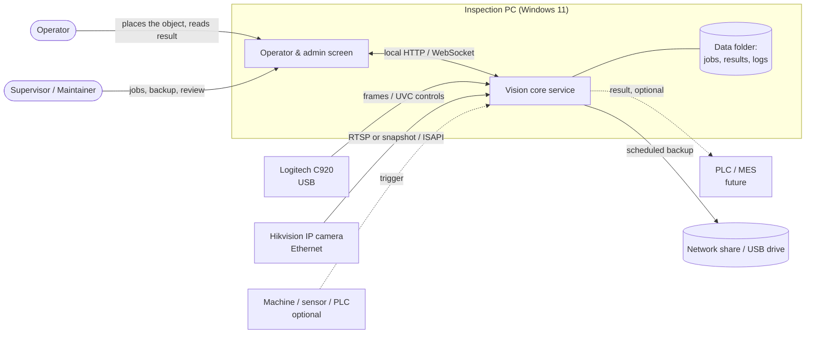
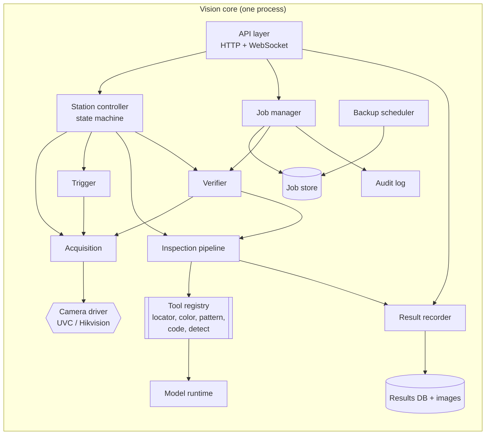
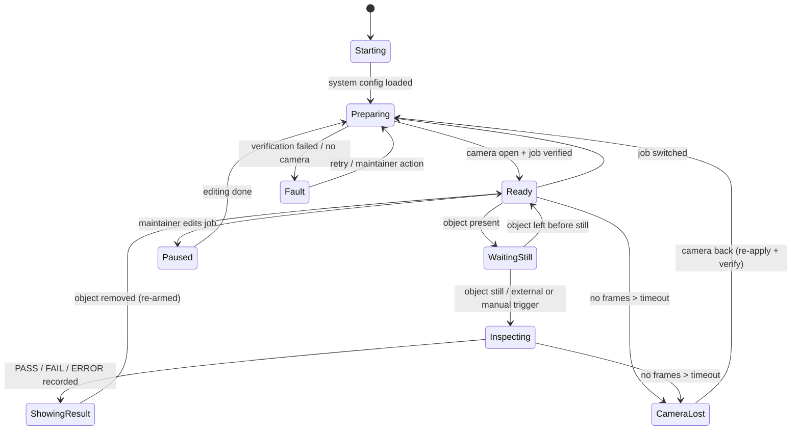
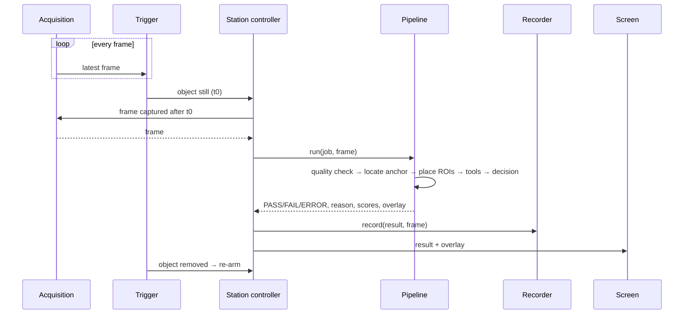

# Vision Station — Architecture ("job" model)

| | |
|---|---|
| Document | 03 — Architecture |
| Version | 0.3 — general platform for fixed stations (TD-19) |
| Date | 2026-10-15 |
| Author | Lucas (developer and maintainer) |
| Status | Platform architecture |

> **Platform (TD-19).** Vision Station is a general vision system for **fixed stations**: a fixed camera and an object that is still while it is inspected. This document describes the platform. A customer project uses it by configuring jobs; its jobs, reference images and context live in that project, not here. Examples (a part with a label on a jig) only illustrate.

Related documents: 01 — Project Scope · 02 — Requirements and Use Cases · 04 — Technical Decisions.

This document describes **how** the system is organized. Library and platform choices are only named where they shape the structure; the reasons for each choice are in document 04. Requirement IDs (FR-…, NFR-…, UC-…) refer to document 02.

---

## 1. Design principles

1. **The job is the unit of configuration.** Everything needed to reproduce an inspection lives inside a job. Nothing that affects a result may live only in code, the registry, or a camera's memory (FR-JOB-2).
2. **Configuration lives on the PC, not on the camera.** The camera is treated as replaceable hardware. Its settings are written from the job on every start and read back. The job never trusts what the camera already holds (FR-ACQ-4).
3. **Saved jobs are never changed.** Editing creates a new version, so any version can be restored exactly (FR-JOB-5).
4. **A job is only active once verified.** Loading, importing or reconnecting always ends with a verification step (FR-JOB-9).
5. **Never a false PASS.** Any doubt (camera lost, bad image, verification failed, internal error) gives ERROR, never PASS (FR-INS-6).
6. **The camera is a plugin.** Inspection and job code never refer to a specific camera (NFR-POR-4).
7. **The inspection core doesn't depend on the OS.** OS-specific code is limited to camera drivers, the service wrapper and the installer (NFR-POR-2).
8. **Simple enough for one maintainer.** One core process, one local database, files on disk. No message brokers, no containers, no cloud (NFR-MAI-4).

The job model follows the vocabulary of the OPC UA Machine Vision companion specification (OPC 40100-1):
- **system configuration**: per installation;
- **recipe**: per product, which we call a job;
- **job execution**: one inspection.

We don't implement OPC UA itself. Using the same concepts keeps a future OPC UA or PLC integration straightforward.

---

## 2. System context



---

## 3. Components



| Component | Responsibility | Requirements |
|---|---|---|
| **Station controller** | Owns the station's state machine (section 6). Runs the inspection cycle, switches jobs, handles camera loss. It is the only component that changes the station's state. | FR-TRG-4, FR-INS-6, UC-01/02/09/10 |
| **Job manager** | Creates, versions, lists, activates, imports and exports jobs. Builds and reads job files and backup files. | FR-JOB-*, UC-03/04/05 |
| **Job store** | Files on disk, one folder per job version, never edited after saving (section 4.4). | FR-JOB-1/5 |
| **Verifier** | Runs the verification procedure on activation, import and reconnect (section 7.3). | FR-JOB-9, FR-ACQ-4/7 |
| **Acquisition** | Keeps the camera open. Holds only the **latest** frame, in a dedicated thread. Hands the station controller a frame captured after a given moment. Detects stalls and reconnects. | FR-ACQ-5/6, NFR-REL-3 |
| **Camera driver** | Camera-specific code behind one interface (section 5). Applies and reads back settings, delivers frames, reports capabilities. | FR-ACQ-1..4/8, NFR-POR-4 |
| **Trigger** | Decides when an object is present and still (or takes a manual, external or continuous trigger, per job). Re-arms only after the object leaves. | FR-TRG-* |
| **Inspection pipeline** | Runs the job's ordered list of tools on one frame and combines their results into PASS / FAIL / ERROR plus a reason. | FR-INS-* |
| **Tool registry** | Named tool types (`color`, `code`, `pattern`, `detect`, TD-19), each with a parameter schema. A job refers to tools by type name and version. | FR-INS-5 |
| **Model runtime** | Loads the job's model file (ONNX), verifies its checksum, runs inference on the CPU. | FR-MDL-3, NFR-PERF-3 |
| **Result recorder** | Writes the inspection record and decides which images to keep. Applies retention and disk limits. | FR-LOG-1..3 |
| **Backup scheduler** | Makes scheduled and on-change backups, verifies them, rotates old ones. | FR-JOB-10 |
| **Audit log** | Append-only record of job changes, imports, exports, overrides and logins. | FR-LOG-5 |
| **API layer** | Local interface used by the screens and, later, by external systems. Pushes the live view, state and results to the screen. | FR-INT-1, FR-UI-* |
| **Operator & admin screen** | Shows the live image, result, reason, state and counters. Logged-in screens for jobs, results, backup and settings. | FR-UI-*, FR-ADM-1 |

### 3.1 Processes

| Process | Runs as | Restart policy |
|---|---|---|
| Vision core | Background service, starts with Windows, runs without a logged-in user | Restarted automatically by the OS service manager on crash (NFR-REL-6) |
| Operator screen | Full-screen app in the operator's session, opened at login | Reconnects to the core if the core restarts |

The screen is just a viewer. If the screen crashes or is closed, inspection keeps running and keeps being recorded.

For the C920 prototype on Windows, opening a USB camera from a background service (no user session) may be blocked by Windows' camera access rules. If that happens, the prototype core runs as a start-up app in the operator's session, with a watchdog. The IP camera has no such limit. To be tested and settled in document 04.

### 3.2 Threads inside the core

| Thread | Work |
|---|---|
| Capture | Reads frames from the camera as fast as they come. Keeps only the newest one and its timestamp. |
| Station | Runs the state machine: trigger detection, inspection, recording. One inspection at a time. |
| API | Serves the screens; streams a reduced live view (≤ 10 fps, NFR-PERF-4). |
| Housekeeping | Backups, retention, disk checks, camera health checks. |

---

## 4. The job

### 4.1 What a job contains

| Part | Content | Why it's in the job |
|---|---|---|
| Metadata | id, name, version, author, created/changed dates, description, parent version | Identify and trace |
| Camera profile | Driver type, resolution, format, exposure, gain, white balance, focus, zoom, and image-processing switches | Same image on any installation |
| Camera raw settings | The driver's own full settings dump (e.g. the Hikvision image-settings XML) | Restores settings we don't model by name |
| Geometry | Optional locator settings; ROIs defined **relative to the anchor** (what the locator found) or to the frame | Tolerates object placement (NFR-ACC-4) |
| Tools | Ordered list: tool type, type version, parameters, thresholds, reason messages | Same decision logic |
| Decision rule | How tool results combine into PASS / FAIL (default: all must pass) | Same final result |
| Trigger settings | Mode (`image_presence`, `manual`, `external`, `continuous`), presence area, stillness time, re-arm rule | Same inspection moment |
| Image-quality limits | Expected brightness and sharpness ranges vs. reference | Detect drift (FR-ACQ-7) |
| Model(s) | ONNX file(s), checksum, input size, class names, model card (training data, date, metrics) | Same model, traceable |
| Reference image | One image of a good object taken when the job was saved | Verify the camera view after restore |
| Reference set | Labeled images with their expected results | Verify the decision logic after restore |

What is **not** in a job: camera IP address and password, which PC folder to back up to, user accounts, licence keys. These belong to the **system configuration** (section 4.5), because they describe the installation, not the product.

### 4.2 Job file format (`.vjob`)

A job file is a ZIP archive with a fixed layout. Text files are UTF-8, and all paths are relative and use `/` (NFR-POR-3).

```
tampa-azul-etiqueta_v7.vjob
├── manifest.json            # format version, job id/version, file list with SHA-256, app version that wrote it
├── job.yaml                 # metadata, geometry, tools, decision rule, trigger, quality limits, screen texts
├── camera/
│   ├── profile.yaml         # normalized camera settings (driver-independent names)
│   └── raw/                 # driver-specific dumps, used only by the same driver
│       └── hikvision-image.xml
├── models/
│   ├── defects.onnx
│   └── defects.card.yaml       # classes, input size, training date, dataset id, metrics
├── reference/
│   ├── reference.png        # golden view of a good object
│   └── reference.meta.yaml  # brightness, sharpness, anchor position measured on it
└── tests/
    ├── expected.yaml        # list of image → expected result, with tolerance on scores
    └── images/*.png
```

Example `job.yaml`, shortened:

```yaml
format: 1
job:
  id: 3f1c9a2e-...          # stays the same across versions
  name: "Tampa azul — etiqueta de lote"
  version: 7
  parent_version: 6
  author: lucas
  created_at: 2026-10-02T15:40:00-03:00
camera_profile: camera/profile.yaml
trigger:
  presence_roi: [0.10, 0.10, 0.90, 0.90]   # fractions of the frame
  still_ms: 400
  mode: image_presence
  rearm: object_absent
quality:
  brightness: {min: 90, max: 170}
  sharpness_min_ratio: 0.7                 # vs. reference
geometry:
  locator: {type: fixed, version: 1, params: {rect: [0.25, 0.20, 0.75, 0.85]}}   # where the jig holds the part
  rois:
    cap: {relative_to: anchor, rect: [0.30, 0.00, 0.70, 0.20]}
    label: {relative_to: anchor, rect: [0.10, 0.45, 0.90, 0.80]}
tools:
  - id: tampa
    type: color
    version: 1
    roi: cap
    params: {hue: [100, 130], s_min: 120, v_min: 70, min_fraction: 0.80}
    reason_fail: "Tampa ausente ou de outra cor ({fraction:.0%} azul)"
  - id: lote
    type: code
    version: 1
    roi: label
    params: {formats: [DataMatrix], pattern: 'L\d{6}'}
    reason_fail: "Código de lote não lido"
  - id: defeitos
    type: detect
    version: 1
    roi: anchor
    params: {model: models/defects.onnx, class_fail: [risco, amassado], conf: 0.5}
    reason_fail: "Defeito na peça: {classes}"
decision: all_pass
ui:
  waiting: "Aguardando peça"   # screen texts come from the job (TD-19)
```

Rules:
- **Checksums:** every file is listed in `manifest.json` with its SHA-256. Import refuses the file if anything is missing or different (FR-JOB-8).
- **Format version:** `format` is an integer. Newer software includes a **migrator** for each older format and upgrades on import, never in place (NFR-MAI-1). Older software refuses a newer format with a clear message.
- **Tool versions:** each tool type carries a version. If the software no longer supports that version of a tool, the job is refused rather than run with different logic.
- **No secrets:** the writer refuses to include anything marked secret (NFR-SEC-1).

### 4.3 Backup file format (`.vbak`)

```
backup_2026-10-02_1800.vbak
├── manifest.json        # backup format, created_at, app version, list of included jobs + SHA-256 of each .vjob
├── system.yaml          # system configuration without secrets
├── active.yaml          # which job/version was active
└── jobs/
    ├── <job-id>/v6.vjob
    ├── <job-id>/v7.vjob
    └── ...
```

- By default the backup includes **every version of every job** (they are small, mostly images). A "latest only" option exists for smaller files.
- Results and recorded images are **not** in the backup. They are records, not configuration, and can be exported separately (FR-LOG-4).

### 4.4 Job store on disk

```
<data root>/
├── system/
│   ├── system.yaml
│   └── active.yaml
├── jobs/
│   └── <job-id>/
│       ├── v6/            # unpacked .vjob, read-only after save
│       └── v7/
├── results/
│   ├── results.db         # one row per inspection
│   └── images/2026/10/02/<inspection-id>.jpg
├── dataset/               # images collected / corrected for training (FR-MDL-1/2)
├── backups/               # local copies before they are sent out
└── logs/
```

- **Saving a job:** the editor works on a draft. On save, the job manager writes `v<n+1>/` to a temporary folder, computes the checksums, then renames it into place. A crash mid-save never leaves a half-written version.
- **Activating a job** changes only `active.yaml`. That write is also atomic: write to a temp file, then replace.
- The store is the only source of truth. The exported `.vjob` is just a packed copy of one version folder, so export and store can't disagree.

### 4.5 System configuration (not part of jobs)

| Item | Where |
|---|---|
| Camera driver and connection (device id / IP, port, user) | `system.yaml` |
| Camera password, user passwords | OS secret store, referenced by name |
| Backup destinations, schedule, retention | `system.yaml` |
| Results retention, PASS-image sampling, disk limit | `system.yaml` |
| Language, station name, shift starts | `system.yaml` |
| Listening address and port | `system.yaml` |

`system.yaml` is validated on load (a damaged file stops the program with the reason; a missing one means the defaults) and refused if any key looks like a secret. Recording limits, backups and the station's settings apply at once when changed; the camera and the network after a restart, which the settings screen says. The file goes into every `.vbak`, so a restore brings the installation's settings back too.

---

## 5. Camera abstraction

### 5.1 Interface

Every camera driver implements the same interface. The rest of the system uses only this.

| Operation | Purpose |
|---|---|
| `open(connection)` / `close()` | Connect and disconnect |
| `capabilities()` | Which settings exist on this unit, their ranges, and whether they can be read back |
| `apply(profile, raw) → report` | Write settings in the correct order. Returns, per setting: applied / not supported / rejected |
| `read_back() → profile, raw` | Read the current settings from the camera |
| `frames()` | Continuous frames for the acquisition thread (each with a timestamp) |
| `snapshot()` | One full-quality still, if the camera offers it |
| `health()` | Connected, frames per second, last frame age |

### 5.2 Normalized settings

The job's `camera/profile.yaml` uses driver-independent names:

```yaml
resolution: [1920, 1080]
pixel_format: mjpeg          # uvc only; ignored by ip drivers
exposure: {mode: manual, value_us: 8000}
gain: {mode: manual, value: 0}
white_balance: {mode: manual, kelvin: 4500}
focus: {mode: manual, value: 30}
zoom: {value: 1200}          # motorized lens only
power_line_hz: 60
low_light_compensation: false
```

Each driver maps these to its own controls. A setting a driver can't apply is reported, never silently skipped (FR-JOB-11). The `raw/` dump is applied only by the driver that wrote it, after the normalized settings, so a Hikvision job restores every image setting even if we haven't named it.

### 5.3 Drivers

| Driver | Frames | Settings | Notes that shape the design |
|---|---|---|---|
| **UVC (C920)** | USB video via the OS camera API | UVC controls through the same API | Some auto modes must be switched off **before** the manual value is accepted, so `apply` works in two passes (modes, wait, values). Values can reset on replug or restart, so the station controller reapplies them on every reconnect. Read-back is required because some writes are silently ignored. |
| **Hikvision** | RTSP main stream over TCP, or HTTP snapshot on trigger | HTTP API (ISAPI) with XML bodies | `raw` = full image-settings XML from the camera. Focus and zoom positions are stored for the motorized lens. The camera boots slower than the PC, so `open` retries. The stream can stall without an error, so `health()` watches the age of the last frame. |
| **File (test)** | Images from a folder | None | Used by automated tests, the verifier's reference-set run, and demos without a camera. |

---

## 6. Station state machine



| State | Screen shows | Result possible |
|---|---|---|
| Starting / Preparing | "Preparando…" | none |
| Ready / WaitingStill | the job's `ui.waiting` text (default "Aguardando objeto") | none |
| Inspecting | "Inspecionando…" | — |
| ShowingResult | PASS / FAIL / ERROR + reason | yes |
| CameraLost | "Câmera desconectada" (yellow) | ERROR if an object was being inspected |
| Fault | "Falha na verificação — chamar manutenção" | none |
| Paused | "Em manutenção" | none |

Nothing outside the `Inspecting` → `ShowingResult` path can produce a PASS. This is how "never a false PASS" is enforced in the structure, not just in the tools.

The state names map to the OPC UA Machine Vision states (Preoperational ≈ Preparing, Initialized/Ready ≈ Ready, SingleExecution ≈ Inspecting, Error ≈ Fault), which keeps a later integration simple.

---

## 7. Main flows

### 7.1 Inspection cycle (UC-01)



- **Fresh frame:** the controller asks for a frame **captured after** the trigger time, never the frame already buffered (FR-ACQ-6). For the Hikvision camera, the job can choose "snapshot on trigger" instead of the stream.
- **Pipeline order:** brightness → locator (if the job has one) → sharpness against the reference → tools in job order. The locator runs before sharpness because an empty station also looks "not sharp"; when the object is not found and the image is not sharp, the reason says both. The pipeline stops at the first ERROR (e.g. no object found) and runs all tools otherwise, so the reason lists every failing tool.
- **Job files:** a tool or locator that needs a file (a template, a model) names it in its parameters; the job is refused on load if the file is missing.
- **Timing budget:** each stage records its duration in the result row, to check against NFR-PERF-1.

### 7.2 Export and backup (UC-04)

1. Pack the version folder (or all jobs + system config) into a temporary file.
2. Write `manifest.json` with SHA-256 of every entry.
3. Copy it to the destination.
4. **Re-open the copy at the destination** and check every checksum.
5. Only then report success and, for scheduled backups, delete the oldest beyond N.

### 7.3 Import and verification (UC-05, FR-JOB-9)


Verification has two parts that catch different problems:

| Part | Catches | Uses |
|---|---|---|
| **Camera and view** (steps 1–4) | Settings not applied, camera moved, lens out of focus, lighting changed | The live camera + `reference/` |
| **Decision logic** (step 5) | Different software version, different model, tool behaving differently on a new PC | Only stored images (`tests/`), no camera needed |

Part 2 also runs in automated tests on every software build (NFR-MAI-3), using the file camera driver. This is how we prove that a restored job gives the same results (NFR-REL-5).

The same verification, without import, runs when a job is selected (UC-02), when the camera reconnects (UC-09), and at start-up (UC-10). Part 2 is optional in those cases (proposed: on job selection and start-up only).

### 7.4 Camera loss and recovery (UC-09)

- **Detection:** the acquisition thread marks the camera lost when the last frame is older than a timeout (proposed: 3 s), or when the driver reports an error.
- **During the outage:** the controller moves to `CameraLost`. An inspection in progress ends as ERROR.
- **Reconnecting:** acquisition retries with increasing delay (1 s → 10 s max).
- **Recovery:** once frames return, the controller goes through `Preparing`: reapply settings, read back, compare with reference. Only then does it go back to `Ready`.

---

## 8. Results and records

| Store | Content |
|---|---|
| `results.db` (SQLite) | One row per inspection: id, timestamp, job id + version, result, reason, per-tool scores (JSON), stage timings, image path or null, operator correction (if any) |
| `images/` | JPEG of the inspection frame for every FAIL and ERROR, and a sample of PASS (FR-LOG-2), with the overlay stored separately so the raw image stays usable for training |
| `dataset/` | Frames saved by collection mode and corrected results, with labels, ready to export for training (FR-MDL-1/2) |
| Audit log | Separate append-only table: who, when, what, before/after version |

**Housekeeping**, hourly:
- Delete records older than the retention period.
- If free disk is below the limit, delete the oldest PASS images first, then the oldest FAIL images (FR-LOG-3, NFR-ENV-2).
- Never delete `jobs/` or `dataset/` automatically.

---

## 9. Models inside jobs

- **Format:** models are ONNX files inside the job, referenced by path and SHA-256. The model runtime refuses a model whose checksum doesn't match (FR-MDL-3).
- **Model card:** each model has a card stating its classes, input size, training dataset id, training date and test metrics. The card is shown in the job editor and on the "About" screen (FR-ADM-3).
- **Replacing a model** = new job version (UC-08). The comparison of FR-MDL-4 is step 5 of the verification, run with both models.
- **Training is outside the core:** training runs offline on the maintainer's machine, from the exported `dataset/`. The core only runs inference, which keeps the production install small and the licensing of the training stack separate (NFR-LIC-1, detailed in document 04).

---

## 10. Interfaces

### 10.1 Local API (core ↔ screens, future integration)

All endpoints live under `/api` (the WebSocket is `/api/live`); every other path is the web interface (document 05, TD-20). The table below lists the first endpoints; the full contract, including the management endpoints, is in document 05 §9.

| Endpoint (proposed) | Purpose |
|---|---|
| `GET /state` | Station state, active job, camera health |
| `GET /result/last` | Last result with reason |
| `WS /live` | Reduced live view + state and result events |
| `POST /trigger` | Manual trigger (FR-TRG-3) and external trigger (FR-TRG-2) |
| `GET/POST /jobs…` | List, activate, export, import (logged-in users only) |
| `GET /results…` | Browse, filter, export CSV, mark incorrect |

- The API listens only on the local machine by default. Opening it to the network is a configuration choice, protected by login (NFR-SEC-3).
- **Other programs (FR-INT-1)** use Vision Station as their vision system through `POST /api/inspections` (an id per request), `GET /api/inspections/{id}` (result and pictures) and the live view; the contract is document 06. Vision Station keeps the camera, the jobs and the decision; the other program keeps its screen, devices and process.
- **Future PLC/MES integration (FR-INT-2)** is added as an **adapter** that subscribes to result events and talks to the external system. It doesn't touch the core.

### 10.2 External trigger

The external trigger arrives through the same `POST /trigger` endpoint, or through a small adapter when the source (a machine, a sensor, a scale) only offers a serial or digital signal. Each adapter is a plugin; the project chooses it (document 02, section 7).

---

## 11. Deployment

| Item | Choice in this architecture |
|---|---|
| Install | One installer: core service + screen + default data root |
| Data root | A single folder outside the program folder, so reinstalling or updating the program never touches jobs or records |
| Update | Replace the program files. The data root is untouched. On first start, jobs in older formats keep working through migrators (FR-ADM-4) |
| Fresh install + restore | Install → set system config (camera address, password, backup folder) → import `.vbak` → verification → production (UC-06, NFR-REL-4) |
| Logs | Rotating text logs in `logs/`, plus a "collect support bundle" action that zips logs, system config without secrets, and the last N results |

---

## 12. How the architecture covers the key requirements

| Requirement | Mechanism |
|---|---|
| Restore after loss (FR-JOB-6..9, NFR-REL-4/5) | Self-contained `.vjob` / `.vbak` with checksums; versions never changed after saving; two-part verification |
| Same behavior on another PC or camera | Settings come from the job, not the camera; read-back; reference image; reference set with expected results |
| Swap C920 → Hikvision (NFR-POR-4) | Camera interface + normalized profile; only the driver changes |
| Never a false PASS (FR-INS-6) | PASS only on the `Inspecting` path; quality gate; ERROR on any doubt |
| Fresh frame per inspection (FR-ACQ-6) | Latest-frame acquisition thread; "frame after t0" request |
| Unattended operation (NFR-REL-1/2/6) | OS service with auto-restart; start-up verification; camera reconnect loop |
| Windows now, Linux possible (NFR-POR-1/2) | OS-specific code only in camera drivers, the service wrapper and the installer |
| One maintainer (NFR-MAI-4) | One process, SQLite and files, no external infrastructure |

---

## 13. Open points

1. **Trigger adapters:** image-based by default; serial and digital-input adapters are written when a project needs them.
2. **Stream vs. snapshot** for the Hikvision camera: decide after testing image quality and delay on the real unit.
3. **Variants:** one job per variant or one job whose tools cover all variants is a project choice; the platform supports both (FR-INS-9).
4. **Screen technology** (desktop app or local web page in kiosk mode): see document 04. The architecture works with either, because the screen only talks to the API.
5. **Tolerances for verification:** brightness, sharpness, position and image similarity. Set from measurements on the prototype.
6. **Core as a Windows service with a USB camera:** confirm it works with the C920; otherwise use the in-session fallback from section 3.1 for the prototype.
